<div align="center">


#### INF2001 Introduction to Software Engineering

# Milestone 2: Detailed Design, Test Plan and Wireframe

### Music School Workload Allocation & Resource Scheduling System

<br><br>

##### Prepared by

##### Team P5-5

<table style="margin: 0 auto; width: 65%; border-collapse: collapse; text-align: center;">
  <thead>
    <tr>
      <th style="text-align: center; font-weight: bold; border: 1pt solid #000; padding: 6pt 16pt;">Student Name</th>
      <th style="text-align: center; font-weight: bold; border: 1pt solid #000; padding: 6pt 16pt;">Student ID</th>
    </tr>
  </thead>
  <tbody>
    <tr>
      <td style="border: 1pt solid #000; padding: 6pt 16pt;">Joseph Poon</td>
      <td style="border: 1pt solid #000; padding: 6pt 16pt;">2501079</td>
    </tr>
    <tr>
      <td style="border: 1pt solid #000; padding: 6pt 16pt;">Ryan Ke</td>
      <td style="border: 1pt solid #000; padding: 6pt 16pt;">2501911</td>
    </tr>
    <tr>
      <td style="border: 1pt solid #000; padding: 6pt 16pt;">Wei Xiang</td>
      <td style="border: 1pt solid #000; padding: 6pt 16pt;">2500686</td>
    </tr>
    <tr>
      <td style="border: 1pt solid #000; padding: 6pt 16pt;">Tan Yan Qi</td>
      <td style="border: 1pt solid #000; padding: 6pt 16pt;">2500030</td>
    </tr>
    <tr>
      <td style="border: 1pt solid #000; padding: 6pt 16pt;">Zayne Lee</td>
      <td style="border: 1pt solid #000; padding: 6pt 16pt;">2503844</td>
    </tr>
    <tr>
      <td style="border: 1pt solid #000; padding: 6pt 16pt; font-weight: bold;">Lab Group:</td>
      <td style="border: 1pt solid #000; padding: 6pt 16pt;">P5 - Team 5</td>
    </tr>
    <tr>
      <td style="border: 1pt solid #000; padding: 6pt 16pt; font-weight: bold;">Date:</td>
      <td style="border: 1pt solid #000; padding: 6pt 16pt;">20 November 2026</td>
    </tr>
  </tbody>
</table>

</div>

<div class="page-break"></div>

<h1>Table of Contents</h1>

<table style="width: 100%; border-collapse: collapse; border: none; font-size: 11pt; line-height: 1.8;">
  <tbody>
    <tr>
      <td style="border: none; padding: 2pt 0; font-weight: bold;">Non-Plagiarism Declaration</td>
      <td style="border: none; padding: 2pt 0; text-align: right; font-weight: bold;">3</td>
    </tr>
    <tr>
      <td style="border: none; padding: 2pt 0; font-weight: bold;">AI Usage</td>
      <td style="border: none; padding: 2pt 0; text-align: right; font-weight: bold;">4</td>
    </tr>
    <tr>
      <td style="border: none; padding: 2pt 0; font-weight: bold;">1 Introduction</td>
      <td style="border: none; padding: 2pt 0; text-align: right; font-weight: bold;">5</td>
    </tr>
    <tr>
      <td style="border: none; padding: 2pt 0 2pt 16pt;">1.1 Team member contributions</td>
      <td style="border: none; padding: 2pt 0; text-align: right;">5</td>
    </tr>
    <tr>
      <td style="border: none; padding: 2pt 0 2pt 16pt;">1.2 Final requirements</td>
      <td style="border: none; padding: 2pt 0; text-align: right;">5</td>
    </tr>
    <tr>
      <td style="border: none; padding: 2pt 0 2pt 16pt;">1.3 Final Class Diagram</td>
      <td style="border: none; padding: 2pt 0; text-align: right;">9</td>
    </tr>
    <tr>
      <td style="border: none; padding: 2pt 0; font-weight: bold;">2 Component Diagram</td>
      <td style="border: none; padding: 2pt 0; text-align: right; font-weight: bold;">11</td>
    </tr>
    <tr>
      <td style="border: none; padding: 2pt 0 2pt 16pt;">2.1 Component Architecture & Subsystems</td>
      <td style="border: none; padding: 2pt 0; text-align: right;">11</td>
    </tr>
    <tr>
      <td style="border: none; padding: 2pt 0 2pt 16pt;">2.2 Provided and Required Interface Contracts</td>
      <td style="border: none; padding: 2pt 0; text-align: right;">13</td>
    </tr>
    <tr>
      <td style="border: none; padding: 2pt 0 2pt 16pt;">2.3 Architectural Design Rationale</td>
      <td style="border: none; padding: 2pt 0; text-align: right;">14</td>
    </tr>
    <tr>
      <td style="border: none; padding: 2pt 0; font-weight: bold;">3 Detailed Design</td>
      <td style="border: none; padding: 2pt 0; text-align: right; font-weight: bold;">16</td>
    </tr>
    <tr>
      <td style="border: none; padding: 2pt 0 2pt 16pt;">3.1 Architecture Design</td>
      <td style="border: none; padding: 2pt 0; text-align: right;">16</td>
    </tr>
    <tr>
      <td style="border: none; padding: 2pt 0 2pt 16pt;">3.2 Detailed Design</td>
      <td style="border: none; padding: 2pt 0; text-align: right;">17</td>
    </tr>
    <tr>
      <td style="border: none; padding: 2pt 0; font-weight: bold;">4 Testing</td>
      <td style="border: none; padding: 2pt 0; text-align: right; font-weight: bold;">20</td>
    </tr>
    <tr>
      <td style="border: none; padding: 2pt 0 2pt 16pt;">4.1 Black Box Testing</td>
      <td style="border: none; padding: 2pt 0; text-align: right;">20</td>
    </tr>
    <tr>
      <td style="border: none; padding: 2pt 0 2pt 16pt;">4.2 White Box Testing</td>
      <td style="border: none; padding: 2pt 0; text-align: right;">24</td>
    </tr>
    <tr>
      <td style="border: none; padding: 2pt 0; font-weight: bold;">5 Wireframe</td>
      <td style="border: none; padding: 2pt 0; text-align: right; font-weight: bold;">28</td>
    </tr>
    <tr>
      <td style="border: none; padding: 2pt 0 2pt 16pt;">5.1 Manager Workload & Studio Utilisation Views</td>
      <td style="border: none; padding: 2pt 0; text-align: right;">28</td>
    </tr>
    <tr>
      <td style="border: none; padding: 2pt 0 2pt 16pt;">5.2 Lesson Allocation & Conflict Matrix View</td>
      <td style="border: none; padding: 2pt 0; text-align: right;">30</td>
    </tr>
    <tr>
      <td style="border: none; padding: 2pt 0 2pt 16pt;">5.3 Teacher Schedule & Availability Views</td>
      <td style="border: none; padding: 2pt 0; text-align: right;">34</td>
    </tr>
    <tr>
      <td style="border: none; padding: 2pt 0 2pt 16pt;">5.4 IT Administration, Compliance Audit Log & Responsive Access Views</td>
      <td style="border: none; padding: 2pt 0; text-align: right;">37</td>
    </tr>
    <tr>
      <td style="border: none; padding: 2pt 0; font-weight: bold;">6 References</td>
      <td style="border: none; padding: 2pt 0; text-align: right; font-weight: bold;">43</td>
    </tr>
  </tbody>
</table>

<div class="page-break"></div>

### Non-Plagiarism Declaration

Students are not allowed to copy assessment solutions from another person or other places. It is the students’ responsibility to guarantee that their solutions are their own work. Meanwhile, the students must also ensure that their work is not accessible by others. Where such plagiarism is detected, both of the assessments involved will receive ZERO mark.

We hereby declare that:

- We fully understand and agree to the abovementioned policy.
- We did not copy any materials from others or from other places.
- We did not share our materials with others or upload to any other places for public access.
- We agree that we will not disclose any information or material of the team project to others or upload to any other places for public access.
- We agree that our project will receive Zero mark if any misalignment with the abovementioned policies is detected.

Declared by: Group P5-5

Team members:
1. Joseph Poon (2501079)
2. Ryan Ke (2501911)
3. Wei Xiang (2500686)
4. Tan Yan Qi (2500030)
5. Zayne Lee (2503844)

Date: 20 November 2026

<div class="page-break"></div>

### AI Usage

In accordance with SIT academic policy, generative AI tools were used as assistive engineering aids during Milestone 2 preparation, as summarized below:

| Document Section | Generative AI Tool | Specific Prompt Intent & Usage Scope | Human Governance, Verification & Modifications |
| :--- | :--- | :--- | :--- |
| **§1.2, §4.1 (Tables)** | Claude Sonnet 5.5 | Markdown table formatting, syntax linting, column alignment. | Replaced generic descriptions with concrete domain attributes; verified truth tables and algebraic reduction. |
| **§1.3, §2.0, §3.2 (Diagrams)** | Claude Opus 5.5 | PlantUML syntax verification, styling parameter checks. | Manually authored all component boundaries, interface contracts, and GoF Strategy structures. |
| **§2.3, §3.1 (Narrative)** | Claude Sonnet 5.5 | Phrasing refinement and technical editing. | Rewrote output to accurately reflect stakeholder interview evidence and statutory citations. |
| **§4.1, §4.2 (Testing Suite)** | Claude Opus 5.5 | Control Flow Graph edge verification and cyclomatic complexity check. | Derived non-binary 3-tier workload basis paths manually, confirmed $V(G) = 6$, and defined full-coverage test parameter specifications. |
| **§5.0 (Wireframes)** | SvelteKit + Tailwind CSS v4 | Interactive component scaffolding and responsive Primer Light layout styling. | Authored domain validation rules, 3-tier statutory status states, role-scoped navigation, and requirement mappings (`FR-01` to `FR-17`). |

Engineering Integrity Confirmation: All core business logic, including the 4-hour continuous teaching limit with mandatory 1-hour rest, instrument-equipped studio matching, monthly 19th 23:59 cutoff window, 2-stage rejection discussion lifecycle, and 3-tier workload classification (`< 40.0h` OK, `40.0h–44.0h` Warning, `> 44.0h` Overworked), was derived directly from stakeholder interviews and manually verified against project specifications.

<div class="page-break"></div>

<div align="center">

# 1 Introduction

</div>

### 1.1 Team member contributions

| Student Name | Student ID | Project Role | Authored Sections & Responsibilities |
| :--- | :--- | :--- | :--- |
| **Joseph Poon** | 2501079 | Lead Architect | Authored the UML 2.5 Component Diagram (§2.0), formulated Service Interface Contracts (§2.2), restructured the Final Class Diagram (§1.3), and designed the White-Box Testing Control Flow Graph (§4.2). |
| **Ryan Ke** | 2501911 | Requirements & QA Lead | Addressed M1 consultation feedback, refined master Functional and Non-Functional Requirements (§1.2), developed Black-Box Decision Table testing methodology, and derived combinatorial reduction (§4.1). |
| **Wei Xiang** | 2500686 | Detailed Design Lead | Conducted Java / Spring Boot architectural pattern analysis (§3.1), evaluated GoF design pattern trade-offs (§3.2.1), formalized Strategy Pattern implementation for candidate tie-breaking (§3.2.2), and specified before-and-after refactoring structures. |
| **Tan Yan Qi** | 2500030 | Test & Verification Lead | Formulated interface method contracts for inter-component communication (§2.2), validated non-binary 3-tier basis path coverage and cyclomatic complexity mathematics (§4.2), and specified full-coverage test case parameters. |
| **Zayne Lee** | 2503844 | Operations Lead | Developed architectural design rationale (§2.3), verified alignment between requirements, use cases, and static wireframe views (§5.0), and compiled the compliance audit trail specification. |

### 1.2 Final requirements
Following the Milestone 1 consultation, the requirement baseline was refined to eliminate scope creep, resolve vague terminology, and enforce atomic specifications meeting the 7 traits of good requirements (cohesive, complete, consistent, atomic, traceable, unambiguous, verifiable).

To enforce sufficiency after the Milestone 1 consultation, the bilateral peer lesson swap (`UC-11` in M1), post-cutoff system availability flagging (`FR-10` and `UC-04` in M1, as late changes are handled offline case-by-case with the manager), standalone substitute workflow (`UC-06` in M1, folded into single-slot allocation `UC-02`), and intermediate draft schedule transition screens were retired, while `UC-11` was reassigned to *Inspect System Audit Log*. Resolving lesson conflicts remains the operational responsibility of the School Manager through the job rejection discussion workflow, and confirming lesson allocations directly triggers teacher notifications. Upon lesson confirmation, each booked slot records its assigned studio location for display to teachers and managers. Teacher weekly workload is evaluated across three non-binary tiers: below 40.0 hours (`OK`), 40.0 to 44.0 hours (`Warning` / authorized overtime), and above 44.0 hours (`Overworked` / statutory ceiling breach [4]). To ensure managers have sufficient scheduling flexibility, instructors must declare at least 60.0 hours of monthly availability.

#### Table 1.1: Final Functional Requirements Specification

| ID | Priority | Functional Requirement Specification | Updates from M1 |
| :--- | :---: | :--- | :--- |
| **FR-01** | Must | The system shall display each teacher's monthly work allocation and assigned studio location upon lesson confirmation. | Added explicit `weeklyHours`, `monthlyHours`, and `assignedLocation` attributes to `Teacher` for monthly allocation and studio display. |
| **FR-02** | Must | The system shall sort and display the top 3 teachers with the lowest allocated weekly hours on the manager dashboard. | Moved 3-tier classification to `FR-16` and color styling to `NFR-USE-02`. |
| **FR-03** | Must | The system shall allow managers to manually allocate unassigned or pending-reallocation 30-minute lesson slots to eligible teachers for a target week. | Generalized single-slot allocation to include rejected and absent slots. |
| **FR-04** | Must | The system shall display up to 3 candidate teachers side-by-side during allocation, showing each candidate's current workload, teaching preferences, and assigned studio location for the specified date. | |
| **FR-05** | Should | The system shall rank eligible candidate teachers by remaining weekly capacity below the 40.0-hour threshold and preferred teaching day match. | Defined workload ranking metric and replaced vague teaching condition terms. |
| **FR-06** | Must | The system shall allow teachers to submit and edit recurring 30-minute availability slots up to 1 month ahead until 23:59 on the 19th of each month, enforcing a minimum declaration of 60.0 hours. | Added 60.0-hour monthly availability floor; retired post-19th system flagging (`FR-10` in M1) for offline consultation. |
| **FR-07** | Must | The system shall allow teachers to specify preferred teaching days and a preferred studio ID within their submitted availability window. | Scoped to preferences; moved 4.0-hour continuous limit to `FR-11`. |
| **FR-08** | Must | The system shall provide teachers with a personal weekly schedule displaying confirmed lessons, assigned studio locations, and enrolled student details. | Replaced contact masking specification with enrolled student details. |
| **FR-09** | Must | The system shall display a warning advising teachers to consult the manager prior to submitting a job rejection request, and flag submitted rejections for manager review. | |
| **FR-10** | Should | The system shall allow IT administrators to schedule studio maintenance periods and exclude studios under maintenance from lesson allocation. | Removed peer lesson swap (`FR-11` in M1) and post-cutoff flagging (`FR-10` in M1) due to scope creep. |
| **FR-11** | Must | The system shall prevent any lesson allocation that causes a teacher to exceed 4.0 continuous teaching hours without a minimum 1.0-hour rest break. | Folded substitute reassignment into `FR-03`; dedicated to 4.0h block limit. |
| **FR-12** | Must | The system shall allow IT administrators to provision user accounts and perform logical account deactivations for Teachers, Managers, and IT Administrators. | |
| **FR-13** | Must | The system shall allow IT administrators to configure studio instrument equipment for Studios 1 to 5 and restrict lesson allocations to studios equipped with the required instrument. | Generalized studio restriction to match lesson instrument against studio equipment. |
| **FR-14** | Must | The system shall notify assigned teachers when lesson allocations are confirmed for a weekly schedule. | Removed intermediate draft schedule state transitions. |
| **FR-15** | Should | The system shall calculate booked versus available studio hours across the 86 weekly operating hours and generate studio utilisation reports for school administration. | |
| **FR-16** | Must | The system shall evaluate teacher weekly working hours across three tiers: acceptable (`< 40.0` hours), overtime warning (`40.0–44.0` hours), and overworked statutory breach (`> 44.0` hours under Employment Act Part IV [4]), and require manager confirmation for allocations in the warning tier. | Consolidated overtime warning and statutory limit checks into a single 3-tier model. |
| **FR-17** | Must | The system shall append an immutable audit log record for every lesson allocation, overtime confirmation, rejection update, and administrative configuration change, and allow managers to inspect the audit trail. | Added explicit audit trail inspection capability. |

*Note on `FR-15` Elicitation & Elapsed Calculation:* Elicited during stakeholder interviews with Academy Director David Koh (`MIN-05-MGT-EXT`) and Operations Manager Marcus Tan (`MIN-01-MGR`) to operationalize studio profitability targets, studio utilisation is computed on demand at report query time `asOf` over elapsed operating hours. Because physical room attendance sensors lie outside software scope, an elapsed 30-minute studio slot counts toward `confirmedElapsedHours` when a persisted `Lesson` holds `status == CONFIRMED` and `endDateTime <= asOf`, while `netAvailableHours` equals elapsed operating hours minus overlapping `MaintenanceWindow` durations.

#### Table 1.2: Final Non-Functional Requirements Specification

| NFR ID | Category | Non-Functional Requirement Specification | Operational & Statutory Justification |
| :--- | :--- | :--- | :--- |
| **NFR-USE-01** | Usability | The system shall render all web interfaces across desktop and mobile viewports (375px to 1920px) without horizontal scrolling. | Enables mobile timetable inspection for teachers and desktop allocation for managers. |
| **NFR-USE-02** | Usability | The system shall display teacher weekly workload status using three visual tiers paired with text badges: Green `OK` (`< 40.0h`), Amber `Warning` (`40.0h–44.0h`), and Red `Overworked` (`> 44.0h`). | Aligns UI visual indicators with the 3-tier workload classification and WCAG 2.2 AA accessibility rules [6]. |
| **NFR-PER-01** | Performance | The system shall complete initial page rendering within 1.5 seconds under a concurrent load of 20 active users. | Ensures responsive scheduling operations during monthly allocation cycles. |
| **NFR-PER-02** | Performance | The system shall evaluate candidate eligibility and clash constraints within 300 milliseconds of slot selection. | Delivers immediate decision support during manual lesson slot allocation. |
| **NFR-REL-01** | Reliability | The system shall maintain at least 99.5% uptime during the monthly scheduling window from the 19th to the 24th of each calendar month. | Prevents scheduling bottlenecks around the monthly availability cutoff. |
| **NFR-REL-02** | Reliability | The system shall execute account and lesson removals exclusively via logical status flags without physical record deletion. | Preserves historical referential integrity for audit and utilisation reporting. |
| **NFR-SEC-01** | Security | The system shall enforce role-based access control restricting teachers to their own schedules and restricting system configuration panels to IT administrators. | Protects staff schedules and prevents unauthorized administrative changes. |
| **NFR-COM-01** | Compliance | The system shall retain immutable audit log records for at least 24 calendar months. | Satisfies Ministry of Manpower statutory employment record retention requirements [4]. |
| **NFR-COM-02** | Compliance | The system shall enforce the 44.0-hour weekly maximum under Employment Act Part IV and record all authorized overtime allocations between 40.0 and 44.0 hours. | Ensures statutory labor compliance across all teaching assignments [4]. |

#### Table 1.3: Final Use Case Summary & Wireframe Traceability

| Use Case ID | Final Use Case Title | Primary Actor | Mapped FRs | Wireframe View |
| :--- | :--- | :--- | :--- | :--- |
| **UC-01** | View Workload Dashboard & Outliers | Manager | `FR-01`, `FR-02`, `FR-16` | `Figure 5.1` |
| **UC-02** | Allocate Lesson Slot | Manager | `FR-03`–`FR-05`, `FR-11`, `FR-13`, `FR-16` | `Figures 5.3–5.5` |
| **UC-03** | Review Rejected Lesson | Manager | `FR-03`, `FR-09` | `Figure 5.6` |
| **UC-05** | Confirm Weekly Schedule & Notify Teachers | Manager | `FR-14` | `Figure 5.1` |
| **UC-07** | Submit Monthly Availability Window | Teacher | `FR-06` | `Figure 5.9` |
| **UC-08** | Submit Weekly Job Preferences | Teacher | `FR-07` | `Figure 5.9` |
| **UC-09** | View Confirmed Schedule & Workload | Teacher | `FR-01`, `FR-08`, `FR-11` | `Figure 5.7` |
| **UC-10** | Submit Job Rejection Request | Teacher | `FR-09` | `Figure 5.8` |
| **UC-11** | Inspect System Audit Log | Manager | `FR-17` | `Figure 5.13` |
| **UC-12–13** | Provision & Deactivate Staff Accounts | IT Admin | `FR-12` | `Figures 5.10–5.11` |
| **UC-14–15** | Configure Studio Equipment & Maintenance | IT Admin | `FR-10`, `FR-13` | `Figure 5.12` |
| **UC-16** | Generate Studio Utilisation Report | Manager | `FR-15` | `Figure 5.2` |
| **UC-17** | Review Labor Compliance | Manager | `FR-16`, `FR-17` | `Figures 5.1, 5.13` |


*Note on M1 Use Case Crosswalk:* Following the §1.2 scope refinements, M1's post-cutoff availability flagging `UC-04` was retired for offline consultation, M1's substitute assignment `UC-06` was folded into `UC-02`, and `UC-11` was reassigned from M1's retired peer lesson swap to *Inspect System Audit Log*.
<div class="page-break"></div>

### 1.3 Final Class Diagram

The final class diagram is organized across two aligned views: `Figure 1.1a` models the presentation boundaries, Spring service interfaces, application controllers, and GoF Strategy pattern realization, while `Figure 1.1b` specifies all persisted domain entities, read-projection DTOs, value objects, and domain enumerations backing the wireframe views and testing contracts. Domain enumerations use canonical `UPPER_SNAKE_CASE` identifiers in UML models, which the presentation layer maps to human-readable labels in the wireframe views, such as `LessonStatus.PENDING_REALLOCATION` for `RejectionPending` and `RejectionReason.GRADE_MISMATCH` for `Pedagogical Grade Mismatch`.

<div style="text-align: center; margin: 14.54pt 0;">
  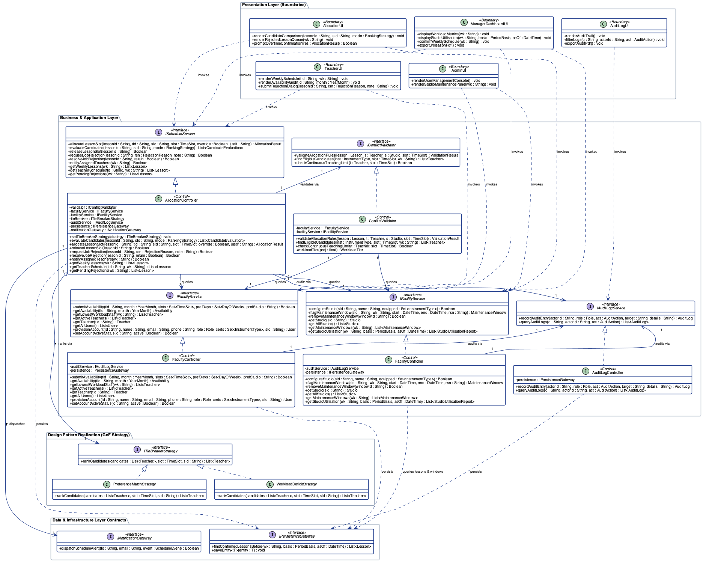
  <em style="color: #666; font-size: 10pt;">Figure 1.1a: Final Class Diagram: Presentation Boundaries, Service Interfaces, Controllers, and Design Patterns</em>
</div>

<div class="page-break"></div>

<div style="text-align: center; margin: 14.54pt 0;">
  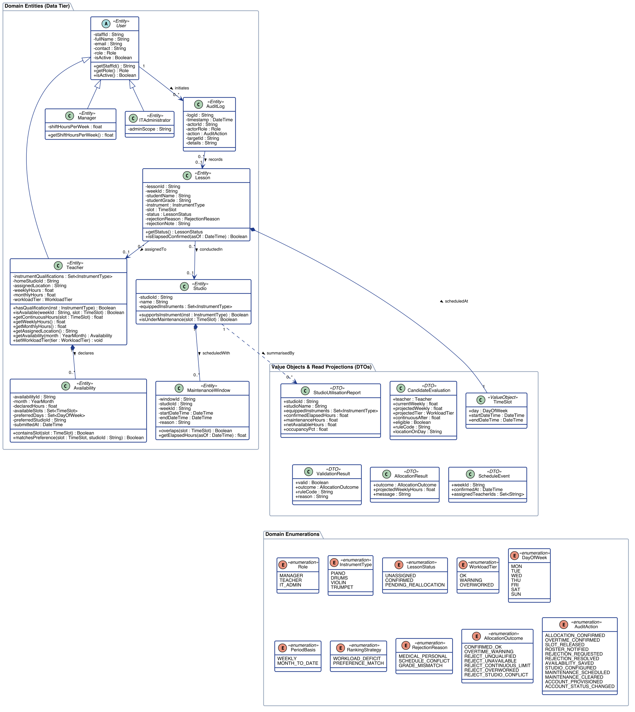
  <em style="color: #666; font-size: 10pt;">Figure 1.1b: Final Class Diagram: Domain Entities, Read Projections / Value Objects, and Enumerations</em>
</div>

<div class="page-break"></div>

<div align="center">

# 2 Component Diagram

</div>

### 2.1 Component Architecture & Subsystems

The UML 2.5 component diagram [1] partitions the **Java 21 and Spring Boot** application into three primary internal layers enclosed within the system boundary, exposing clean Spring service interfaces and isolating external infrastructure gateways.

<div style="text-align: center; margin: 14.54pt 0;">
  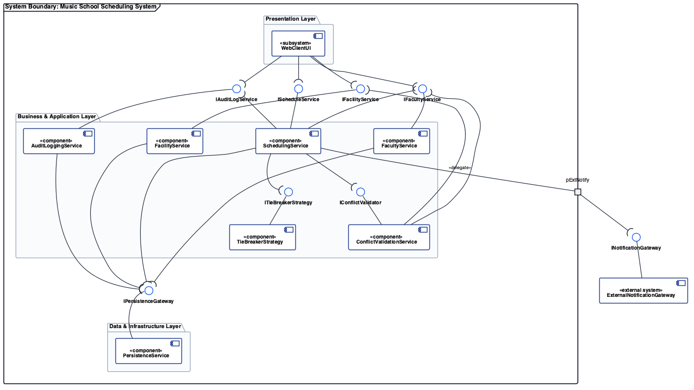
  <em style="color: #666; font-size: 10pt;">Figure 2.1: UML 2.5 Component Diagram for Music School Scheduling System</em>
</div>

Table 2.1 maps each architectural component in `Figure 2.1` to its provided and required interfaces, its realising classes in `Figure 1.1a`, and its operational responsibility:

#### Table 2.1: Component-to-Class Realisation & Subsystem Mapping

| UML Component (`Figure 2.1`) | Provided / Required Interfaces | Realising Classes (`Figure 1.1a`) | Architectural Responsibility |
| :--- | :--- | :--- | :--- |
| **WebClientUI** | Requires `IScheduleService`, `IFacultyService`, `IFacilityService`, `IAuditLogService` | `ManagerDashboardUI`, `AllocationUI`, `TeacherUI`, `AdminUI`, `AuditLogUI` | Presentation boundary subsystem invoking provided business service interfaces. |
| **SchedulingService** | Provides `IScheduleService`; Requires `IConflictValidator`, `ITieBreakerStrategy`, `IFacultyService`, `IFacilityService`, `IAuditLogService`, `IPersistenceGateway`, `INotificationGateway` | `AllocationController` | Central Spring `@Service` component orchestrating lesson slot allocation, candidate ranking, job rejection review, and teacher schedule notifications. |
| **ConflictValidationService** | Provides `IConflictValidator`; Requires `IFacultyService`, `IFacilityService` | `ConflictValidator` | Domain validation component checking instrument qualifications, room equipment, 4.0-hour continuous limits, and the 3-tier weekly workload model. |
| **TieBreakerStrategy** | Provides `ITieBreakerStrategy` | `WorkloadDeficitStrategy`, `PreferenceMatchStrategy` | Encapsulates interchangeable GoF Strategy algorithms for ranking eligible candidate teachers. |
| **FacultyService** | Provides `IFacultyService`; Requires `IAuditLogService`, `IPersistenceGateway` | `FacultyController` | Manages teacher profiles, assigned studio locations, monthly availability windows, and weekly workload totals. |
| **FacilityService** | Provides `IFacilityService`; Requires `IAuditLogService`, `IPersistenceGateway` | `FacilityController` | Manages physical room metadata for Studios 1 to 5, instrument configurations, maintenance windows, and studio utilisation reports. |
| **AuditLoggingService** | Provides `IAuditLogService`; Requires `IPersistenceGateway` | `AuditLogController` | Centralized regulatory logging service maintaining append-only historical ledgers and compliance query tools. |
| **PersistenceService** | Provides `IPersistenceGateway` | Spring Data JPA Repositories | Executes transactional entity persistence and elapsed confirmed-lesson queries against PostgreSQL. |
| **ExternalNotificationGateway** | Provides `INotificationGateway` via `pExtNotify` | SMTP / SMS Infrastructure Adapter | External adapter situated outside the system boundary to dispatch automated timetable alerts to assigned teachers. |
### 2.2 Provided and Required Interface Contracts

Every exposed interface realizes strict method contracts ensuring compile-time safety and decoupled communication across component boundaries:

`IScheduleService` (Provided by SchedulingService, Required by WebClientUI):
- `allocateLessonSlot(lessonId: String, tId: String, sId: String, slot: TimeSlot, override: Boolean, justif: String): AllocationResult`
- `evaluateCandidates(lessonId: String, sId: String, mode: RankingStrategy): List<CandidateEvaluation>`
- `releaseLessonSlot(lessonId: String): Boolean`
- `requestJobRejection(lessonId: String, rsn: RejectionReason, note: String): Boolean`
- `resolveJobRejection(lessonId: String, retain: Boolean): Boolean`
- `notifyAssignedTeachers(wk: String): Boolean`
- `getWeeklyLessons(wk: String): List<Lesson>`
- `getTeacherSchedule(tId: String, wk: String): List<Lesson>`
- `getPendingRejections(wk: String): List<Lesson>`

`IConflictValidator` (Provided by ConflictValidationService, Required by SchedulingService):
- `validateAllocationRules(lesson: Lesson, t: Teacher, s: Studio, slot: TimeSlot): ValidationResult`
- `findEligibleCandidates(inst: InstrumentType, slot: TimeSlot, wk: String): List<Teacher>`
- `checkContinuousTeachingLimit(t: Teacher, slot: TimeSlot): Boolean`

`IFacultyService` (Provided by FacultyService, Required by WebClientUI, SchedulingService, ConflictValidationService):
- `submitAvailability(tId: String, month: YearMonth, slots: Set<TimeSlot>, prefDays: Set<DayOfWeek>, prefStudio: String): Boolean`
- `getAvailability(tId: String, month: YearMonth): Availability`
- `getLowestWorkloadStaff(wk: String): List<Teacher>`
- `getActiveTeachers(): List<Teacher>`
- `getTeacher(tId: String): Teacher`
- `getAllUsers(): List<User>`
- `provisionAccount(id: String, name: String, email: String, phone: String, role: Role, certs: Set<InstrumentType>, sId: String): User`
- `setAccountActiveStatus(id: String, active: Boolean): Boolean`

`IFacilityService` (Provided by FacilityService, Required by WebClientUI, SchedulingService, ConflictValidationService):
- `configureStudio(sId: String, name: String, equipped: Set<InstrumentType>): Boolean`
- `flagMaintenanceWindow(sId: String, wk: String, start: DateTime, end: DateTime, rsn: String): MaintenanceWindow`
- `removeMaintenanceWindow(windowId: String): Boolean`
- `getStudio(sId: String): Studio`
- `getAllStudios(): List<Studio>`
- `getMaintenanceWindows(wk: String): List<MaintenanceWindow>`
- `getStudioUtilisation(wk: String, basis: PeriodBasis, asOf: DateTime): List<StudioUtilisationReport>`

`IAuditLogService` (Provided by AuditLoggingService, Required by WebClientUI, SchedulingService, FacultyService, FacilityService):
- `recordAuditEntry(actorId: String, role: Role, act: AuditAction, target: String, details: String): AuditLog`
- `queryAuditLogs(q: String, actorId: String, act: AuditAction): List<AuditLog>`

`ITieBreakerStrategy` (Provided by TieBreakerStrategy, Required by SchedulingService):
- `rankCandidates(candidates: List<Teacher>, slot: TimeSlot, sId: String): List<Teacher>`

`IPersistenceGateway` (Provided by PersistenceService, Required by SchedulingService, FacultyService, FacilityService, AuditLoggingService):
- `findConfirmedLessonsBefore(wk: String, basis: PeriodBasis, asOf: DateTime): List<Lesson>`
- `saveEntity<T>(entity: T): void`

`INotificationGateway` (Provided by ExternalNotificationGateway via `pExtNotify`, Required by SchedulingService):
- `dispatchScheduleAlert(tId: String, email: String, event: ScheduleEvent): Boolean`

### 2.3 Architectural Design Rationale

The software architecture prioritizes three primary quality attributes derived from stakeholder elicitation:

1. **Modifiability:** Music academies periodically revise operational policies, including statutory overtime thresholds, instrument qualifications, and rest break durations. To prevent these policy changes from rippling across the codebase, the architecture isolates constraint verification inside `ConflictValidationService` and candidate ranking inside `ITieBreakerStrategy`, enabling developers to update scheduling rules while keeping presentation views and persistence schemas unchanged.
2. **Reliability & Data Integrity:** Prior manual spreadsheet workflows frequently produced room double-bookings and unrecorded overtime because assignments were entered without automated verification. By routing every scheduling request through `IScheduleService`, the architecture enforces mandatory conflict validation before any database commit and immediately delegates state mutations to `IAuditLogService`, guaranteeing conflict-free schedules and a complete 24-month statutory audit trail.
3. **Usability & Operational Responsiveness:** School managers must evaluate and assign dozens of weekly lesson slots under tight monthly deadlines, which requires rapid feedback during candidate comparison. Separating read-optimized candidate filtering (`IConflictValidator`) from full schedule persistence allows the system to evaluate eligibility constraints in memory within 300 milliseconds, providing immediate conflict indicators on the allocation screen.
<div class="page-break"></div>

<div align="center">

# 3 Detailed Design

</div>

### 3.1 Architecture Design

The system implements a strict Hierarchical Layered Architecture [5] in **Java 21 with Spring Boot**, organized into three closed tiers: Presentation Layer (Spring MVC / Thymeleaf Web Boundary), Business and Application Layer (Spring `@Service` Domain Controllers and Strategies), and Data and Infrastructure Layer (Spring Data JPA Repositories with PostgreSQL and SMTP/SMS Gateways).

<div style="text-align: center; margin: 14.54pt 0;">
  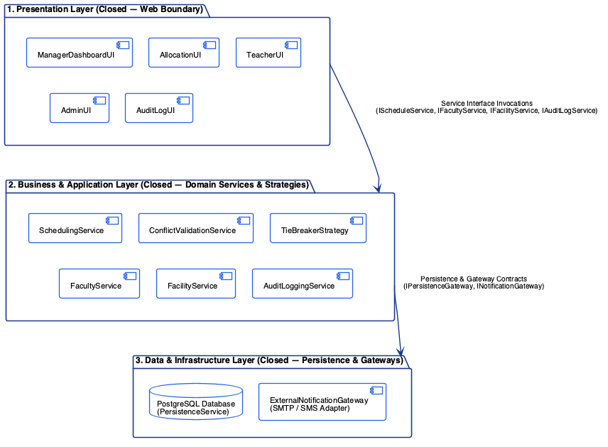
  <em style="color: #666; font-size: 10pt;">Figure 3.1: 3-Tier Hierarchical Layered Architecture for Music School Scheduling System</em>
</div>
In accordance with closed layering rules, layer-skipping is strictly prohibited. Requests flow sequentially downward through the business controllers, and domain data returns synchronously back through the calling hierarchy.
Architectural Pattern Comparison:

| Evaluated Architecture | Structural Characteristics | Suitability Analysis for Scheduling System |
| :--- | :--- | :--- |
| Hierarchical Layered (Selected) | Partitions system horizontally into closed Presentation, Business, and Persistence layers. Each layer depends only on the layer immediately below it. | Selected: Enforces clean separation of concerns, guarantees that business rules and statutory overtime checks cannot be bypassed by UI components, and simplifies unit test isolation. |
| Model-View-Controller (MVC) | Separates UI rendering (View) and user inputs (Controller) from domain entities (Model). | Adopted within Presentation Tier: Boundary views capture user inputs and delegate to controllers, but MVC alone lacks formal boundaries for complex domain validation services. |
| Microservices Architecture | Distributes application logic across independent, network-partitioned service processes. | Rejected: Introduces unnecessary network latency, distributed transaction complexity, and DevOps overhead for an academy with 9 teachers and 5 studios. |

### 3.2 Detailed Design

#### 3.2.1 Design Pattern Evaluation & Trade-off Analysis

To resolve detailed design problems within the scheduling core, four Gang of Four (GoF) patterns [2] were evaluated against operational requirements:

| Evaluated Pattern | Target Operational Problem | Architectural Trade-offs & Analysis | Selection Outcome |
| :--- | :--- | :--- | :--- |
| Strategy Pattern | Dynamic candidate teacher ranking across competing operational heuristics (workload deficit vs preference match). | Pros: Decouples candidate sorting algorithms from allocation controllers; satisfies Open/Closed Principle.<br>Cons: Increases class count slightly.<br>Verdict: Long-term extensibility outweighs minimal class boilerplate. | Selected (Implemented) |
| Observer Pattern | Broadcasting schedule confirmation events to multiple asynchronous notification subscribers. | Pros: Decouples event producers from multiple independent listener channels.<br>Cons: Adds subscriber lifecycle overhead when weekly schedule confirmation dispatches through a single outbound `INotificationGateway` port.<br>Verdict: Direct gateway delegation satisfies `FR-14` with lower structural complexity. | Evaluated (Rejected) |
| Factory Method | Instantiating specialized User accounts (Teacher, Manager, ITAdministrator) during onboarding. | Pros: Encapsulates role creation.<br>Cons: Account onboarding occurs infrequently; adds unnecessary abstraction over simple constructors. | Evaluated (Rejected) |
| Singleton Pattern | Providing global access to the scheduling engine or system configuration registry. | Pros: Single point of access.<br>Cons: Introduces global state, tightly couples callers to concrete implementations, and hinders test isolation. | Evaluated (Rejected) |

#### 3.2.2 Strategy Pattern (Selected)

Operational Problem: When allocating an unassigned lesson, multiple teachers often satisfy all hard eligibility constraints (qualified, available, within 4.0-hour continuous teaching limits, and at or below the 44.0-hour cap). The system must rank these candidates to guide manager selection. Under nominal operations, management prioritizes faculty equity by ranking teachers by remaining capacity below the 40.0-hour threshold. In specialized cases, management prioritizes teacher satisfaction by ranking candidates by preferred teaching days and studio assignments.

Hardcoding this ranking logic into `AllocationController` violates the Open/Closed Principle (OCP) and Single Responsibility Principle (SRP). Adding new ranking heuristics requires modifying and recompiling core scheduling classes. The Strategy Pattern decouples algorithmic ranking from scheduling orchestration.

Structural Template:

<div style="text-align: center; margin: 14.54pt 0;">
  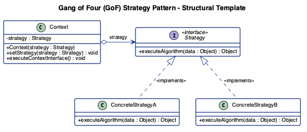
  <em style="color: #666; font-size: 10pt;">Figure 3.2: Gang of Four Strategy Pattern Standard Structural Template</em>
</div>

<div class="page-break"></div>

Before Pattern Implementation:

<div style="text-align: center; margin: 14.54pt 0;">
  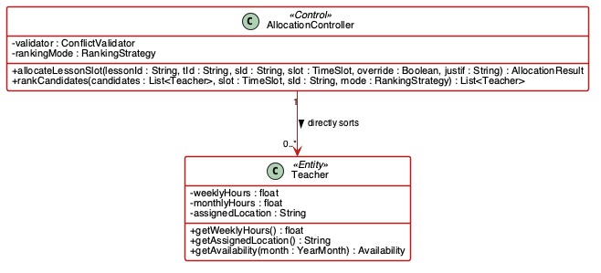
  <em style="color: #666; font-size: 10pt;">Figure 3.3: Class Excerpt Before Strategy Implementation</em>
</div>

After Strategy Pattern Implementation:

<div style="text-align: center; margin: 14.54pt 0;">
  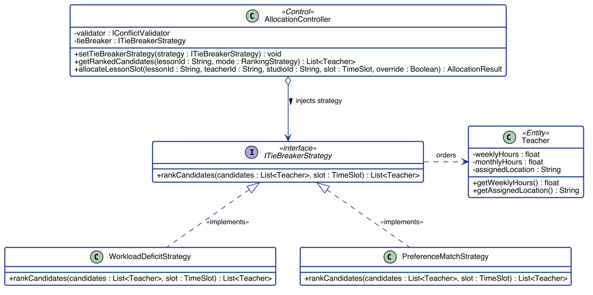
  <em style="color: #666; font-size: 10pt;">Figure 3.4: Class Excerpt After Strategy Implementation</em>
</div>

In this refactored structure, `AllocationController` acts as the Context, holding a reference to the `ITieBreakerStrategy` interface. Concrete strategies `WorkloadDeficitStrategy` and `PreferenceMatchStrategy` encapsulate independent sorting algorithms. When managers toggle ranking preferences in `AllocationUI`, the controller dynamically swaps the active strategy instance without modifying orchestration code.

<div class="page-break"></div>

<div align="center">

# 4 Testing

</div>

### 4.1 Black Box Testing

Black-box testing evaluates `AllocationController.allocateLessonSlot(lessonId, tId, sId, slot, override, justif)`, realizing `IScheduleService` within `SchedulingService`, using Decision Table Testing and Boundary Value Analysis [5]. Given a target `lessonId`, selected teacher `tId`, target studio `sId`, 30-minute `TimeSlot`, `override` flag, and manager justification `justif`, the method validates five independent operational constraints via `IConflictValidator`: teacher instrument qualification, declared teacher slot availability, compliance with the 4.0-hour continuous teaching block limit, projected weekly workload across the three statutory tiers, and studio equipment, occupancy, and maintenance availability. Expected behaviour: when any hard constraint fails, including an unqualified teacher, unavailable slot, continuous hours exceeding 4.0 hours, projected weekly hours exceeding 44.0 hours, or studio conflict, the method preserves existing schedule state and returns `AllocationResult` with the corresponding `REJECT_*` outcome; when all constraints pass below 40.0 weekly hours, it persists the confirmed booking, records an audit entry, and returns `CONFIRMED_OK`; when projected hours fall within 40.0 to 44.0 hours with `override = false`, it returns `OVERTIME_WARNING` to prompt mandatory manager justification before committing.

#### 4.1.1 Causes, Effects, and Combination Count

Table 4.1 defines the input causes and output effects for lesson allocation. Cause `C4` has three possible values corresponding to the teacher's projected weekly workload tier (`< 40.0h`, `40.0h–44.0h`, `> 44.0h`), while `C1`, `C2`, `C3`, and `C5` are binary (`Y, N`):

$$\text{Total Combinations} = \prod_{i=1}^{5} V_i = 2 \times 2 \times 2 \times 3 \times 2 = 48 \text{ combinations}$$

#### Table 4.1: Complete Decision Table (48 Combinations Grouped by Indifferent States)

| Causes | Values | 1–24 | 25–36 | 37–42 | 43–44 | 45 | 46 | 47 | 48 |
| :--- | :--- | :---: | :---: | :---: | :---: | :---: | :---: | :---: | :---: |
| **C1: Teacher Qualified** | Y, N | N | Y | Y | Y | Y | Y | Y | Y |
| **C2: Teacher Available** | Y, N | Y, N | N | Y | Y | Y | Y | Y | Y |
| **C3: Continuous Hours $\le 4.0\text{h}$** | Y, N | Y, N | Y, N | N | Y | Y | Y | Y | Y |
| **C4: Projected Weekly Workload** | `< 40h`, `40–44h`, `> 44h` | Any | Any | Any | `> 44h` | `40–44h` | `< 40h` | `40–44h` | `< 40h` |
| **C5: Studio Valid & Available** | Y, N | Y, N | Y, N | Y, N | Y, N | N | N | Y | Y |
| **Effects** | | | | | | | | | |
| **E1: Confirm Allocation (`OK`)** | | | | | | | | | X |
| **E2: Overtime Warning Prompt** | | | | | | | | X | |
| **E3: Reject (Unqualified)** | | X | | | | | | | |
| **E4: Reject (Unavailable)** | | | X | | | | | | |
| **E5: Reject (Continuous Limit)** | | | | X | | | | | |
| **E6: Reject (Overworked `> 44h`)** | | | | | X | | | | |
| **E7: Reject (Studio Conflict)** | | | | | | X | X | | |

#### 4.1.2 Reduced Decision Table

Collapsing indifferent combinations (`-`) where upstream validation failures determine the outcome yields 7 reduced decision rules:

#### Table 4.2: Reduced Decision Table

| Causes | Values | R1 (1–24) | R2 (25–36) | R3 (37–42) | R4 (43–44) | R5 (45–46) | R6 (47) | R7 (48) |
| :--- | :--- | :---: | :---: | :---: | :---: | :---: | :---: | :---: |
| **C1: Teacher Qualified** | Y, N | N | Y | Y | Y | Y | Y | Y |
| **C2: Teacher Available** | Y, N | - | N | Y | Y | Y | Y | Y |
| **C3: Continuous Hours $\le 4.0\text{h}$** | Y, N | - | - | N | Y | Y | Y | Y |
| **C4: Projected Weekly Workload** | `< 40h`, `40–44h`, `> 44h` | - | - | - | `> 44h` | `< 40h`, `40–44h` | `40–44h` | `< 40h` |
| **C5: Studio Valid & Available** | Y, N | - | - | - | - | N | Y | Y |
| **Effects** | | | | | | | | |
| **E1: Confirm Allocation (`OK`)** | | | | | | | | X |
| **E2: Overtime Warning Prompt** | | | | | | | X | |
| **E3: Reject (Unqualified)** | | X | | | | | | |
| **E4: Reject (Unavailable)** | | | X | | | | | |
| **E5: Reject (Continuous Limit)** | | | | X | | | | |
| **E6: Reject (Overworked `> 44h`)** | | | | | X | | | |
| **E7: Reject (Studio Conflict)** | | | | | | X | | |

#### 4.1.3 Black-Box Test Cases

#### Table 4.3: Black-Box Test Cases for `allocateLessonSlot()`

| Test ID | Rule | Test Data / Input Parameters | Expected Result |
| :--- | :---: | :--- | :--- |
| **TC-BB-01** | R1 | `lessonId`: `"L-101"`<br>`instrument`: `DRUMS`<br>`tId`: `"T-01"` (`qualifications`: `[PIANO]`)<br>`isAvailable`: `true`<br>`continuousHours`: `1.0h`<br>`weeklyHours`: `22.0h` (projected `22.5h`)<br>`sId`: `"S-05"` (Drum-equipped, Free)<br>`override`: `false`, `justif`: `""` | Rejected with `REJECT_UNQUALIFIED` (`E3`: Teacher lacks required instrument certification). |
| **TC-BB-02** | R2 | `lessonId`: `"L-102"`<br>`instrument`: `PIANO`<br>`tId`: `"T-02"` (`qualifications`: `[PIANO]`)<br>`isAvailable`: `false`<br>`continuousHours`: `1.0h`<br>`weeklyHours`: `22.0h` (projected `22.5h`)<br>`sId`: `"S-01"` (Piano-equipped, Free)<br>`override`: `false`, `justif`: `""` | Rejected with `REJECT_UNAVAILABLE` (`E4`: Teacher unavailable for selected slot). |
| **TC-BB-03** | R3 | `lessonId`: `"L-103"`<br>`instrument`: `PIANO`<br>`tId`: `"T-03"` (`qualifications`: `[PIANO]`)<br>`isAvailable`: `true`<br>`continuousHours`: `4.0h` (projected `4.5h`)<br>`weeklyHours`: `28.0h` (projected `28.5h`)<br>`sId`: `"S-01"` (Piano-equipped, Free)<br>`override`: `false`, `justif`: `""` | Rejected with `REJECT_CONTINUOUS_LIMIT` (`E5`: Continuous 4.0h teaching limit exceeded). |
| **TC-BB-04** | R4 | `lessonId`: `"L-104"`<br>`instrument`: `PIANO`<br>`tId`: `"T-04"` (`qualifications`: `[PIANO]`)<br>`isAvailable`: `true`<br>`continuousHours`: `1.5h`<br>`weeklyHours`: `44.0h` (projected `44.5h`)<br>`sId`: `"S-01"` (Piano-equipped, Free)<br>`override`: `false`, `justif`: `""` | Rejected with `REJECT_OVERWORKED` (`E6`: Exceeds 44.0h statutory cap). |
| **TC-BB-05A** | R5 | `lessonId`: `"L-105"`<br>`instrument`: `PIANO`<br>`tId`: `"T-05"` (`qualifications`: `[PIANO]`)<br>`isAvailable`: `true`<br>`continuousHours`: `1.0h`<br>`weeklyHours`: `30.0h` (projected `30.5h`)<br>`sId`: `"S-04"` (Active `MaintenanceWindow`)<br>`override`: `false`, `justif`: `""` | Rejected with `REJECT_STUDIO_CONFLICT` (`E7`: Studio under scheduled maintenance). |
| **TC-BB-05B** | R5 | `lessonId`: `"L-106"`<br>`instrument`: `DRUMS`<br>`tId`: `"T-06"` (`qualifications`: `[DRUMS]`)<br>`isAvailable`: `true`<br>`continuousHours`: `1.0h`<br>`weeklyHours`: `30.0h` (projected `30.5h`)<br>`sId`: `"S-01"` (Piano-only Studio, Free)<br>`override`: `false`, `justif`: `""` | Rejected with `REJECT_STUDIO_CONFLICT` (`E7`: Studio lacks required drum equipment). |
| **TC-BB-05C** | R5 | `lessonId`: `"L-107"`<br>`instrument`: `PIANO`<br>`tId`: `"T-05"` (`qualifications`: `[PIANO]`)<br>`isAvailable`: `true`<br>`continuousHours`: `1.0h`<br>`weeklyHours`: `30.0h` (projected `30.5h`)<br>`sId`: `"S-02"` (Occupied by Confirmed Lesson)<br>`override`: `false`, `justif`: `""` | Rejected with `REJECT_STUDIO_CONFLICT` (`E7`: Studio already booked for target slot). |
| **TC-BB-06A** | R6 | `lessonId`: `"L-108"`<br>`instrument`: `PIANO`<br>`tId`: `"T-07"` (`qualifications`: `[PIANO]`)<br>`isAvailable`: `true`<br>`continuousHours`: `2.0h`<br>`weeklyHours`: `39.5h` (projected `40.0h`)<br>`sId`: `"S-02"` (Piano-equipped, Free)<br>`override`: `false` $\rightarrow$ `true`, `justif`: `"Cover demand"` | Returns `OVERTIME_WARNING` at `40.0h` lower boundary (`E2`); commits upon `override = true`. |
| **TC-BB-06B** | R6 | `lessonId`: `"L-109"`<br>`instrument`: `PIANO`<br>`tId`: `"T-07"` (`qualifications`: `[PIANO]`)<br>`isAvailable`: `true`<br>`continuousHours`: `2.5h`<br>`weeklyHours`: `43.5h` (projected `44.0h`)<br>`sId`: `"S-02"` (Piano-equipped, Free)<br>`override`: `false` $\rightarrow$ `true`, `justif`: `"Recital prep"` | Returns `OVERTIME_WARNING` at `44.0h` upper boundary (`E2`); commits upon `override = true`. |
| **TC-BB-07** | R7 | `lessonId`: `"L-110"`<br>`instrument`: `DRUMS`<br>`tId`: `"T-06"` (`qualifications`: `[DRUMS]`)<br>`isAvailable`: `true`<br>`continuousHours`: `3.5h` (projected `4.0h`)<br>`weeklyHours`: `39.0h` (projected `39.5h`)<br>`sId`: `"S-05"` (Drum-equipped, Free)<br>`override`: `false`, `justif`: `""` | Confirmed with `CONFIRMED_OK` (`E1`); persists assignment and records audit entry. |

### 4.2 White Box Testing

White-box testing evaluates `ConflictValidator.findEligibleCandidates(instrument, slot, weekId)` using Control Flow Testing and Basis Path derivation to achieve 100% statement coverage and 100% branch coverage. Given a required `InstrumentType`, a target 30-minute `TimeSlot`, and a calendar `weekId`, the method iterates through the active faculty pool and sequentially verifies whether each teacher holds the required instrument certification, has declared availability for the slot, and remains within the 4.0-hour continuous teaching limit upon adding the 0.5-hour lesson. Expected behaviour: teachers failing qualification, availability, or continuous-block checks, or whose projected weekly workload exceeds the 44.0-hour statutory cap (`OVERWORKED`), are excluded, whereas eligible teachers below 40.0 hours (`OK`) or between 40.0 and 44.0 hours (`WARNING`) are tagged with their corresponding status tier and returned in `List<Teacher>`.

#### 4.2.1 Method Pseudocode

```java
List<Teacher> findEligibleCandidates(
    InstrumentType inst, TimeSlot slot, String wk) {
  List<Teacher> eligible = new ArrayList<>();              // N1
  List<Teacher> pool = facultyService.getActiveTeachers();
  int i = 0;
  while (i < pool.size()) {                                // N2
    Teacher c = pool.get(i);
    if (c.hasQualification(inst) && c.isAvailable(wk, slot)) { // N3
      if (c.getContinuousHours(slot) + 0.5f <= 4.0f) {     // N4
        float proj = c.getWeeklyHours() + 0.5f;
        switch (workloadTier(proj)) {                      // N5
          case OK:         c.setWorkloadTier(OK);
            eligible.add(c); break;                        // N6
          case WARNING:    c.setWorkloadTier(WARNING);
            eligible.add(c); break;                        // N7
          case OVERWORKED:
            c.setWorkloadTier(OVERWORKED); break;          // N8
        }
      }
    }
    i = i + 1;                                             // N9
  }
  return eligible;                                         // N10
}
```

#### 4.2.2 Control Flow Graph

Each node in the Control Flow Graph maps directly to an atomic statement block or decision predicate in `findEligibleCandidates()`:
- **`Node 1` (Initialization):** Instantiates the empty `eligible` list, loads `pool` via `facultyService.getActiveTeachers()`, and sets loop index `i = 0`.
- **`Node 2` (Loop Predicate):** Evaluates `i < pool.size()`; branches to `Node 3` on `True` or exits to `Node 10` on `False`.
- **`Node 3` (Qualification & Availability Guard):** Evaluates `c.hasQualification(inst) && c.isAvailable(wk, slot)`; proceeds to `Node 4` on `True` or skips to `Node 9` on `False`.
- **`Node 4` (Continuous Block Guard):** Evaluates `c.getContinuousHours(slot) + 0.5f <= 4.0f`; proceeds to `Node 5` on `True` or skips to `Node 9` on `False`.
- **`Node 5` (3-Tier Workload Switch):** Evaluates projected weekly hours (`proj`) across three non-binary statutory branches:
  - **`Node 6` (`< 40.0h`):** Sets `c.setWorkloadTier(OK)` and appends the candidate to `eligible`.
  - **`Node 7` (`40.0h–44.0h`):** Sets `c.setWorkloadTier(WARNING)` and appends the candidate to `eligible`.
  - **`Node 8` (`> 44.0h`):** Sets `c.setWorkloadTier(OVERWORKED)` and excludes the candidate.
- **`Node 9` (Loop Advance):** Increments `i = i + 1` and returns control to `Node 2`.
- **`Node 10` (Method Exit):** Returns the filtered `eligible` candidate list.

<div style="text-align: center; margin: 12pt 0;">
  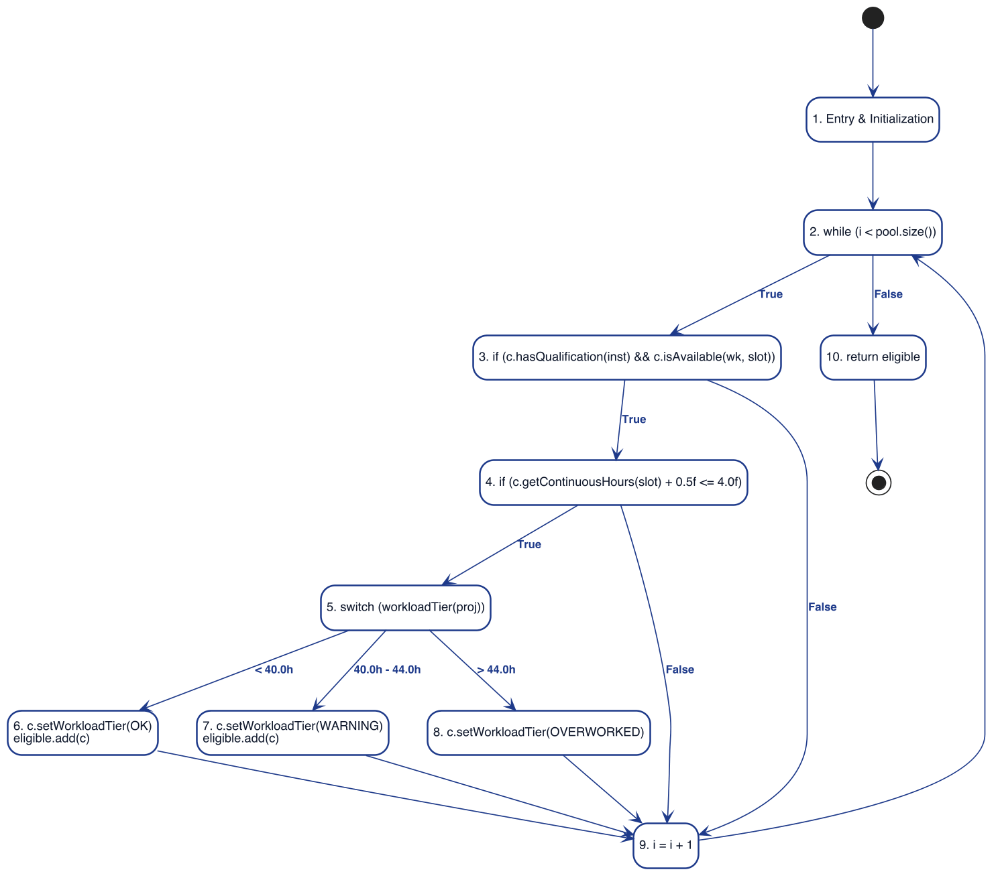
  <em style="color: #666; font-size: 10pt;">Figure 4.1: Control Flow Graph for ConflictValidator.findEligibleCandidates()</em>
</div>

#### 4.2.3 Cyclomatic Complexity

Cyclomatic complexity $M$ [3] defines the number of linearly independent paths through the Control Flow Graph:

$$M = E - N + 2P$$

- $E = 14$ edges
- $N = 10$ nodes
- $P = 1$ connected component

$$M = 14 - 10 + 2(1) = 6$$

#### 4.2.4 Basis Paths

Following the baseline-and-flip method across the 6 linearly independent paths:

1. **Path 1 (Baseline: Tier 1 `< 40.0h`):** `1 - 2 - 3 - 4 - 5 - 6 - 9 - 2 - 10`
2. **Path 2 (Flip Node 5 to Tier 2 `40.0h–44.0h`):** `1 - 2 - 3 - 4 - 5 - 7 - 9 - 2 - 10`
3. **Path 3 (Flip Node 5 to Tier 3 `> 44.0h`):** `1 - 2 - 3 - 4 - 5 - 8 - 9 - 2 - 10`
4. **Path 4 (Flip Node 4: Continuous Limit Exceeded):** `1 - 2 - 3 - 4 - 9 - 2 - 10`
5. **Path 5 (Flip Node 3: Unqualified or Unavailable):** `1 - 2 - 3 - 9 - 2 - 10`
6. **Path 6 (Flip Node 2: Empty Faculty Pool):** `1 - 2 - 10`

#### 4.2.5 White-Box Test Cases

#### Table 4.4: White-Box Test Cases for `findEligibleCandidates()`

| Test ID | Basis Path | Input Parameters | Projected Weekly Hours | Expected Output |
| :--- | :---: | :--- | :---: | :--- |
| **TC-WB-01** | Path 1 | `instrument`: `PIANO`<br>`slot`: `Tue 14:00–14:30`<br>`staffId`: `"T-01"`<br>`qualifications`: `[PIANO]`<br>`isAvailable`: `true`<br>`continuousHours`: `3.5h`<br>`weeklyHours`: `39.0h` | `39.5h` | Candidate `"T-01"` returned with `workloadTier = OK`. |
| **TC-WB-02A** | Path 2 | `instrument`: `PIANO`<br>`slot`: `Tue 14:00–14:30`<br>`staffId`: `"T-02"`<br>`qualifications`: `[PIANO]`<br>`isAvailable`: `true`<br>`continuousHours`: `2.0h`<br>`weeklyHours`: `39.5h` | `40.0h` | Candidate `"T-02"` returned with `workloadTier = WARNING` at lower tier boundary. |
| **TC-WB-02B** | Path 2 | `instrument`: `PIANO`<br>`slot`: `Tue 14:00–14:30`<br>`staffId`: `"T-03"`<br>`qualifications`: `[PIANO]`<br>`isAvailable`: `true`<br>`continuousHours`: `1.5h`<br>`weeklyHours`: `43.5h` | `44.0h` | Candidate `"T-03"` returned with `workloadTier = WARNING` at upper tier boundary. |
| **TC-WB-03** | Path 3 | `instrument`: `PIANO`<br>`slot`: `Tue 14:00–14:30`<br>`staffId`: `"T-04"`<br>`qualifications`: `[PIANO]`<br>`isAvailable`: `true`<br>`continuousHours`: `1.0h`<br>`weeklyHours`: `44.0h` | `44.5h` | Candidate excluded with `workloadTier = OVERWORKED`; returns empty list. |
| **TC-WB-04** | Path 4 | `instrument`: `PIANO`<br>`slot`: `Tue 14:00–14:30`<br>`staffId`: `"T-05"`<br>`qualifications`: `[PIANO]`<br>`isAvailable`: `true`<br>`continuousHours`: `4.0h`<br>`weeklyHours`: `25.0h` | `25.5h` | Candidate excluded at Node 4 (`4.5h > 4.0h` continuous limit); returns empty list. |
| **TC-WB-05A** | Path 5 | `instrument`: `PIANO`<br>`slot`: `Tue 14:00–14:30`<br>`staffId`: `"T-06"`<br>`qualifications`: `[VIOLIN]`<br>`isAvailable`: `true`<br>`continuousHours`: `1.0h`<br>`weeklyHours`: `20.0h` | `20.5h` | Candidate excluded at Node 3 (unqualified); returns empty list. |
| **TC-WB-05B** | Path 5 | `instrument`: `PIANO`<br>`slot`: `Tue 14:00–14:30`<br>`staffId`: `"T-07"`<br>`qualifications`: `[PIANO]`<br>`isAvailable`: `false`<br>`continuousHours`: `1.0h`<br>`weeklyHours`: `20.0h` | `20.5h` | Candidate excluded at Node 3 (unavailable); returns empty list. |
| **TC-WB-06** | Path 6 | `instrument`: `PIANO`<br>`slot`: `Tue 14:00–14:30`<br>`facultyPool`: `[]` | N/A | Loop bypassed at Node 2; returns empty list. |

<div align="center">

# 5 Wireframe

</div>

The interactive prototype is implemented in Svelte 5, SvelteKit, and Tailwind CSS v4 using a monochromatic GitHub Primer Light visual system, applying semantic color exclusively to the 3-tier statutory workload indicators (`NFR-USE-02`) and scaling across `375px` mobile and `1920px` desktop viewports without horizontal page overflow (`NFR-USE-01`).

### 5.1 Manager Workload & Studio Utilisation Views
- Use Cases: `UC-01`, `UC-05`, `UC-16`
- Requirements: `FR-01`, `FR-02`, `FR-14`, `FR-15`, `FR-16`, `NFR-USE-02`
- Screen Purpose: Summarizes weekly and monthly teacher allocations, assigned studio locations, top-3 lowest-workload priorities, 3-tier statutory statuses, and 86-hour weekly studio utilisation metrics.
- Key Elements:
  1. Priority Balancing Queue & 3-Tier Ledger: Ranks the 3 lowest-allocated teachers at the top (`FR-02`) above the 9-teacher allocation table displaying assigned studios (`FR-01`), monthly hours, Green `OK` (`< 40.0h`), Amber `Warning` (`40.0h–44.0h`), and Red `Overworked` (`> 44.0h`) status badges (`FR-16`, `NFR-USE-02`), and slot release controls (`releaseLessonSlot`).
  2. Schedule Confirmation & Notification: Dispatches schedule notifications to all active teachers via `Confirm & Notify Teachers` (`FR-14`).
  3. Studio Utilisation Breakdown: Queries `IFacilityService.getStudioUtilisation(wk, basis, asOf)` across completed `Week 46` (`09–15 Nov`) or month-to-date elapsed periods, aggregating `confirmedElapsedHours` (`status == CONFIRMED` and `endDateTime <= asOf`), scheduled `MaintenanceWindow` hours, and `netAvailableHours` across Studios 1 to 5 (`FR-15`) with PDF export.

<div style="text-align: center; margin: 14pt 0;">
  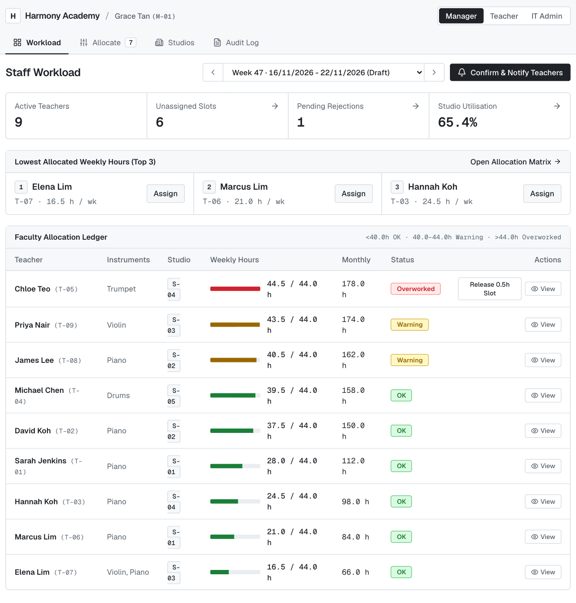
  <em style="color: #666; font-size: 10pt;">Figure 5.1: Manager Staff Workload Dashboard & Top-3 Balancing Queue</em>
</div>

<div style="text-align: center; margin: 14pt 0;">
  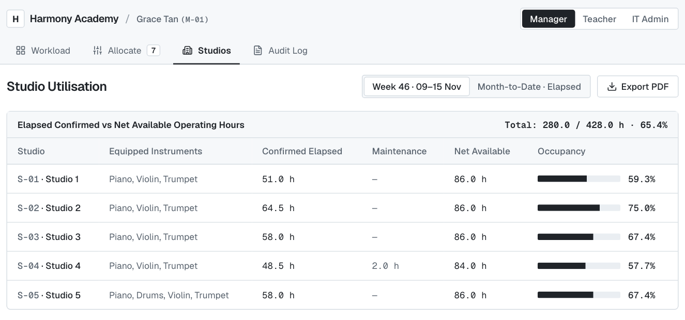
  <em style="color: #666; font-size: 10pt;">Figure 5.2: Studio Utilisation Report</em>
</div>

### 5.2 Lesson Allocation & Conflict Matrix View
- Use Cases: `UC-02`, `UC-03`
- Requirements: `FR-03`, `FR-04`, `FR-05`, `FR-09`, `FR-10`, `FR-11`, `FR-13`, `FR-16`, `NFR-PER-02`
- Screen Purpose: Evaluates unassigned and pending-rejection 30-minute lesson slots against candidate qualifications, availability, continuous blocks, statutory workload caps, and studio constraints within 300 milliseconds (`NFR-PER-02`).
- Key Elements:
  1. Side-by-Side Candidate Comparison & Strategy Toggle: Compares up to 3 eligible teachers side-by-side showing projected weekly hours, continuous block progress (`FR-11`), preferences, and daily studio location (`FR-04`), dynamically re-ordered between `Workload Deficit` (`Figure 5.3`) and `Preference Match` (`Figure 5.4`, `FR-05`), while listing pre-filtered `R1`/`R2` exclusions below.
  2. Overtime Confirmation Gate & Studio Guardrails: Restricts studio selection to equipped rooms (`FR-13`), disables studios under scheduled maintenance (`S-04`, `Rule R5`, `FR-10`), and opens a mandatory justification prompt whenever an assignment enters the `40.0h–44.0h` warning tier (`Figure 5.5`, `Rule R6`, `FR-16`).
  3. Rejected Lesson Review & Reallocation: Surfaces teacher-flagged rejection notes alongside a one-click `Retain` option or immediate substitute candidate reallocation (`Figure 5.6`, `UC-03`, `FR-03`, `FR-09`).

<div style="text-align: center; margin: 14pt 0;">
  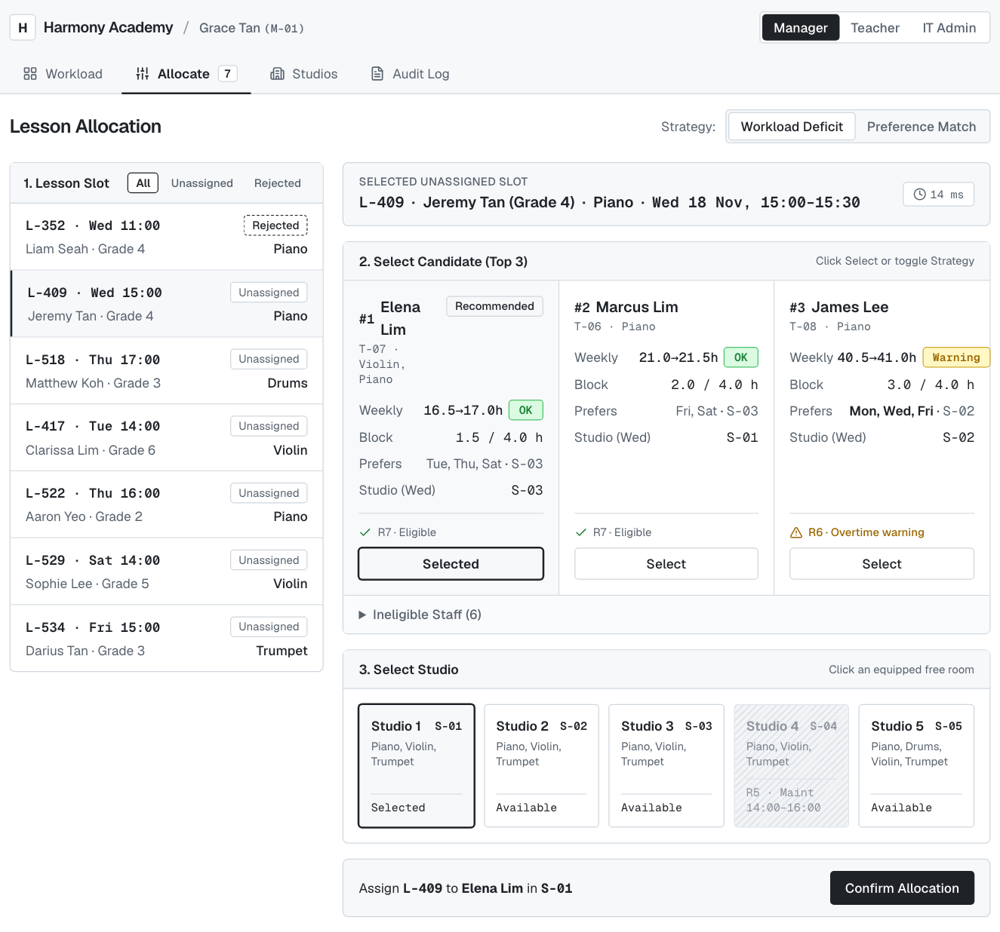
  <em style="color: #666; font-size: 10pt;">Figure 5.3: Lesson Allocation Matrix Ranked by Workload Deficit Strategy</em>
</div>

<div style="text-align: center; margin: 14pt 0;">
  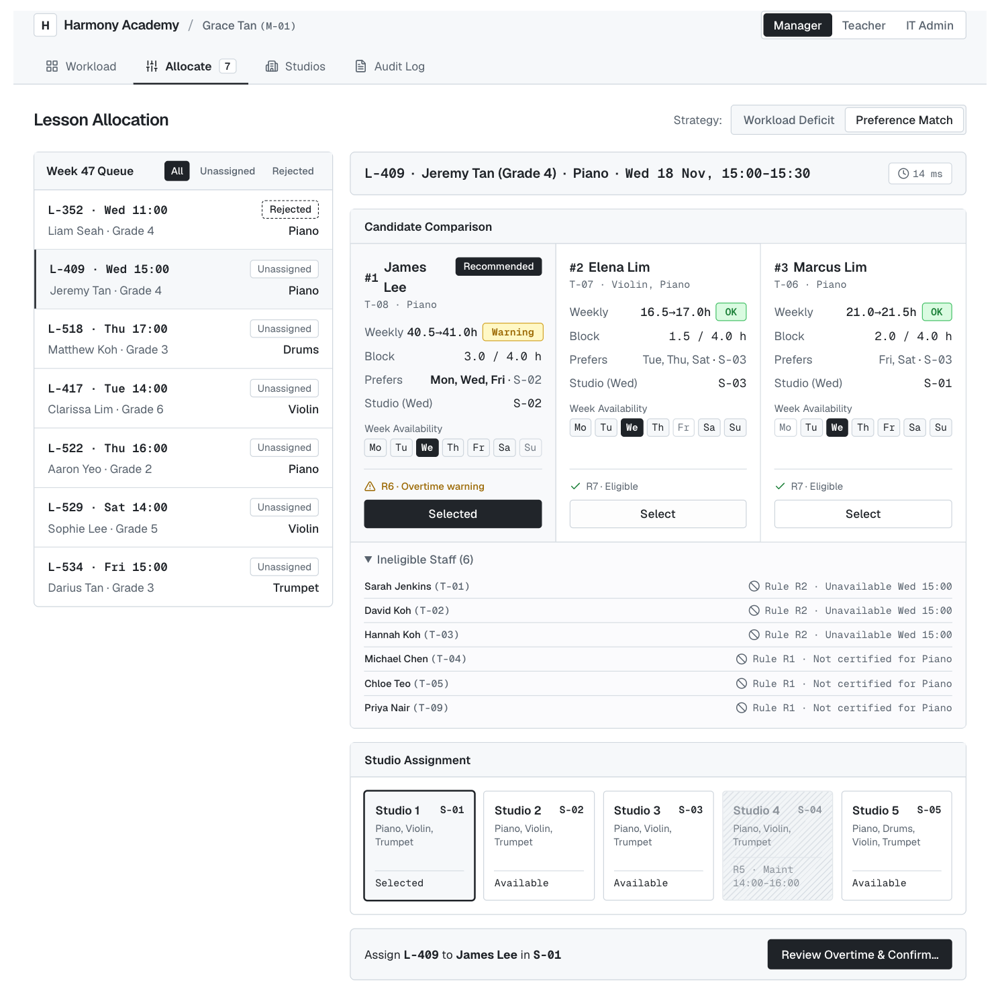
  <em style="color: #666; font-size: 10pt;">Figure 5.4: Lesson Allocation Matrix Re-Ranked by Preference Match Strategy</em>
</div>

<div style="text-align: center; margin: 14pt 0;">
  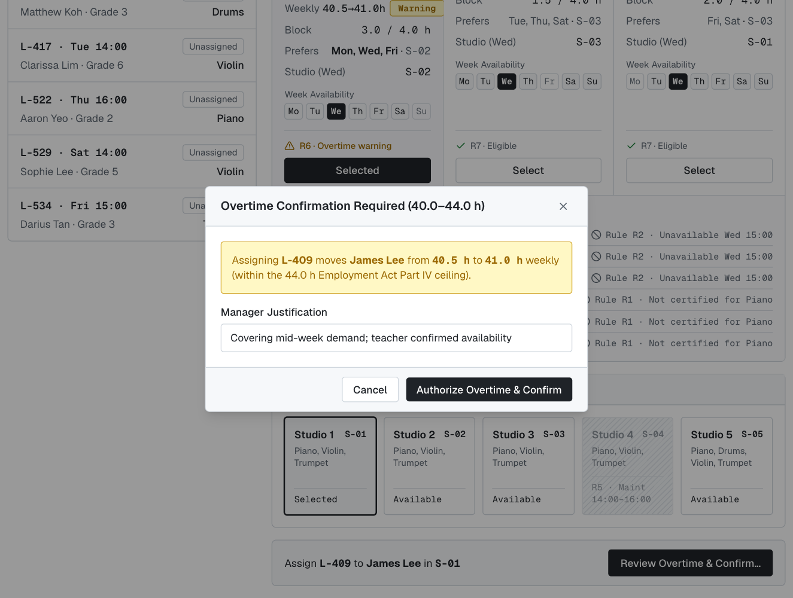
  <em style="color: #666; font-size: 10pt;">Figure 5.5: Mandatory Manager Overtime Confirmation Dialog (40.0h–44.0h Warning Tier)</em>
</div>

<div style="text-align: center; margin: 14pt 0;">
  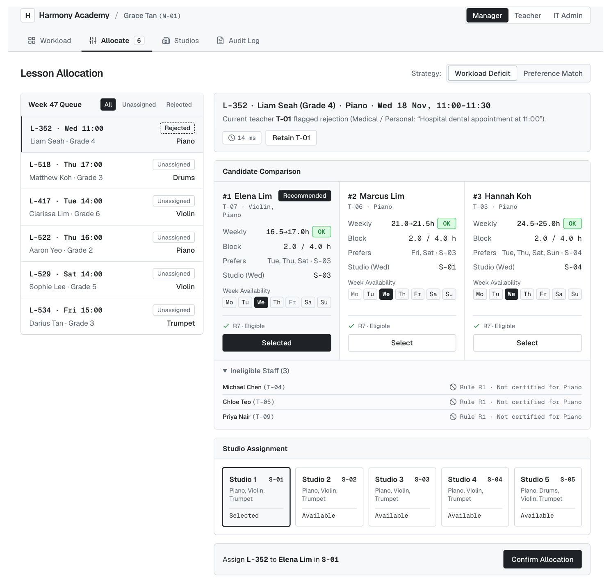
  <em style="color: #666; font-size: 10pt;">Figure 5.6: Manager Review of Teacher-Flagged Job Rejection Request</em>
</div>

### 5.3 Teacher Schedule & Availability Views
- Use Cases: `UC-07`, `UC-08`, `UC-09`, `UC-10`
- Requirements: `FR-01`, `FR-06`, `FR-07`, `FR-08`, `FR-09`, `FR-11`, `NFR-USE-01`, `NFR-SEC-01`
- Screen Purpose: Restricts authenticated teachers to their personal weekly timetable, job rejection consultation workflow, and monthly availability and preference declarations (`NFR-SEC-01`).
- Key Elements:
  1. Weekly Schedule Calendar: Renders confirmed 30-minute lessons across Monday to Sunday with monthly allocated hours, enrolled student names and grades (`FR-08`), assigned studio IDs (`FR-01`), hatched `1.0h Rest` intervals following `4.0h` continuous blocks (`FR-11`), and dashed `Pending` rejection markers (`Figure 5.7`).
  2. Job Rejection Consultation Warning Dialog: Selecting a confirmed lesson displays full student details alongside the mandatory warning advising manager consultation prior to submitting a rejection request (`Figure 5.8`, `FR-09`).
  3. Monthly Availability & Preferences Grid: Captures recurring 30-minute availability slots before `23:59` on the 19th while enforcing the `60.0h` monthly minimum (`FR-06`), paired with preferred teaching days and preferred studio selection (`Figure 5.9`, `FR-07`).

<div style="text-align: center; margin: 14pt 0;">
  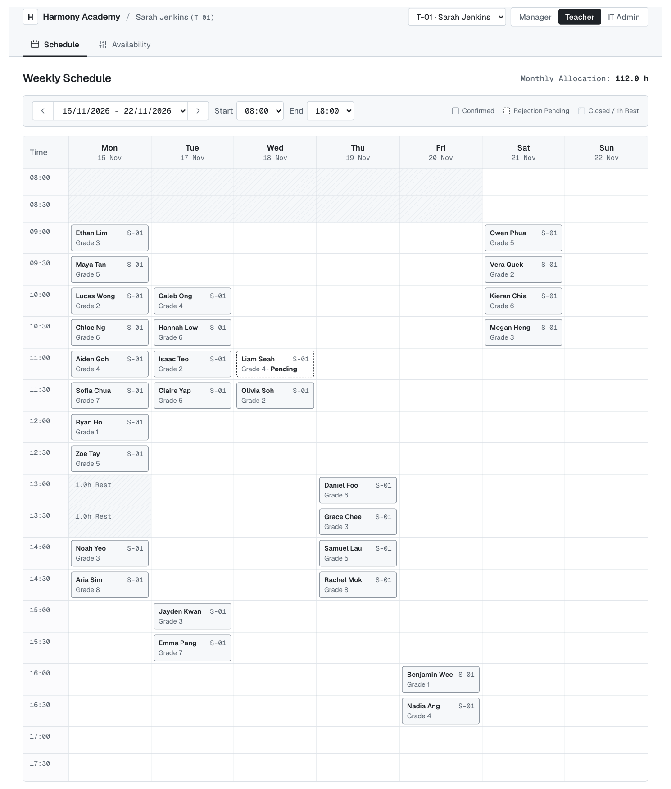
  <em style="color: #666; font-size: 10pt;">Figure 5.7: Teacher Weekly Schedule Grid with Assigned Studios & Rest Breaks</em>
</div>

<div style="text-align: center; margin: 14pt 0;">
  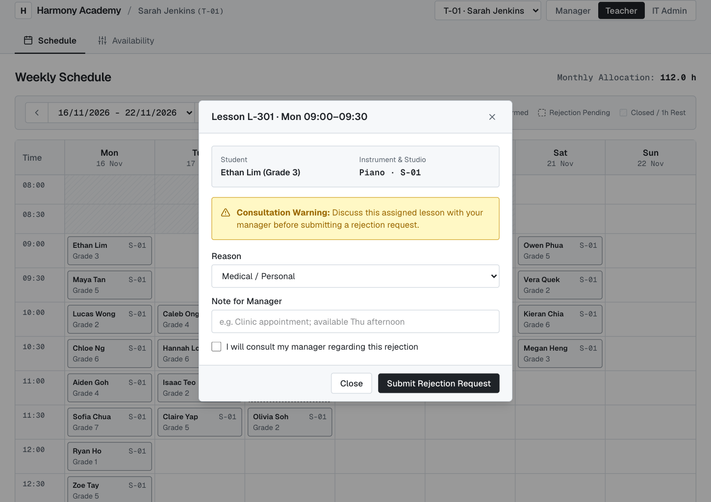
  <em style="color: #666; font-size: 10pt;">Figure 5.8: Student Slot Details & Mandatory Consultation Warning Rejection Dialog</em>
</div>

<div style="text-align: center; margin: 14pt 0;">
  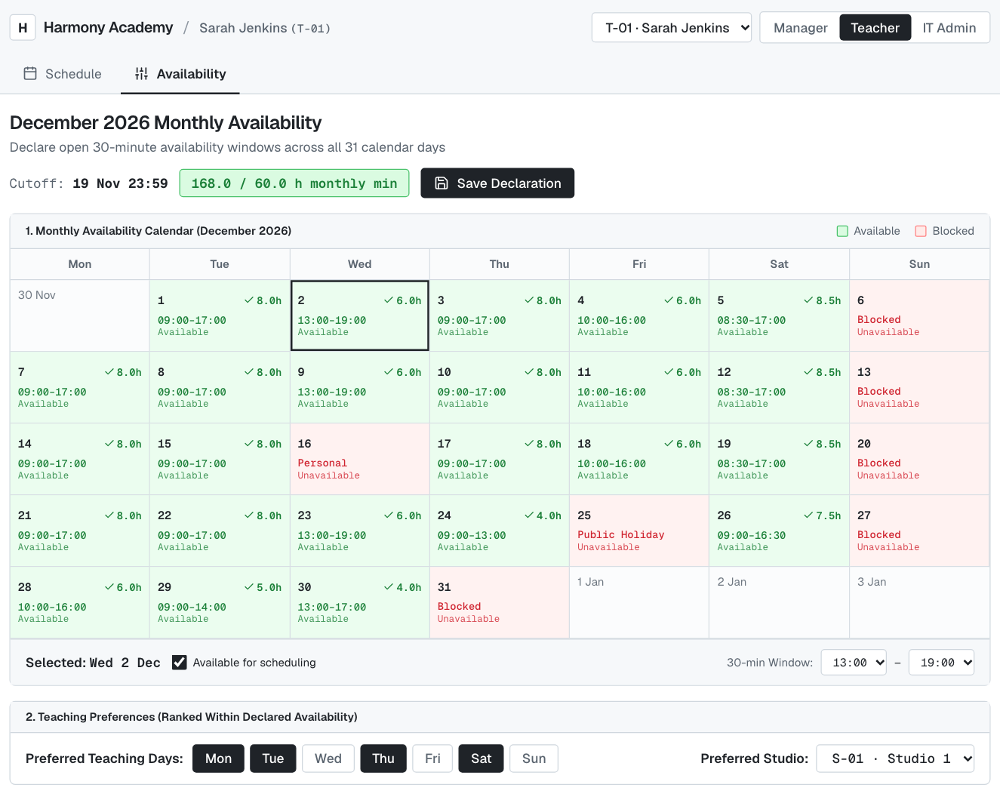
  <em style="color: #666; font-size: 10pt;">Figure 5.9: Teacher Monthly 30-Minute Availability Grid & Preferences</em>
</div>

### 5.4 IT Administration, Compliance Audit Log & Responsive Access Views
- Use Cases: `UC-11`, `UC-12`–`UC-15`, `UC-17`
- Requirements: `FR-10`, `FR-12`, `FR-13`, `FR-17`, `NFR-USE-01`, `NFR-REL-02`, `NFR-SEC-01`, `NFR-COM-01`, `NFR-COM-02`
- Screen Purpose: Isolates user lifecycle and studio facility configuration to IT Administrators (`NFR-SEC-01`), provides Managers with an append-only 24-month compliance audit trail, and verifies role-based access enforcement and `375px` mobile responsiveness.
- Key Elements:
  1. Account Provisioning & Logical Deactivation: Supports role-filtered account search, logical status deactivation (`T-10 Ruth Gomez`, `Figure 5.10`), and Staff ID, school email, certified instrument, and home studio assignment during account creation (`Figure 5.11`, `FR-12`, `NFR-REL-02`).
  2. Studio Equipment & Maintenance Controls: Configures `equippedInstruments` per studio (`S-05` sole drum room, `FR-13`) and schedules or clears maintenance blackout windows (`Figure 5.12`, `FR-10`).
  3. Immutable Compliance Audit Trail & NFR Verification: Filters append-only scheduling and configuration mutations by search term, actor, and action retained for 24 calendar months with PDF export (`Figure 5.13`, `FR-17`, `NFR-COM-01`, `NFR-COM-02`), enforces `403` route isolation across unauthorized roles (`Figure 5.14`, `NFR-SEC-01`), and renders cleanly at `375px` mobile width with zero horizontal overflow (`Figure 5.15`, `NFR-USE-01`).

<div style="text-align: center; margin: 14pt 0;">
  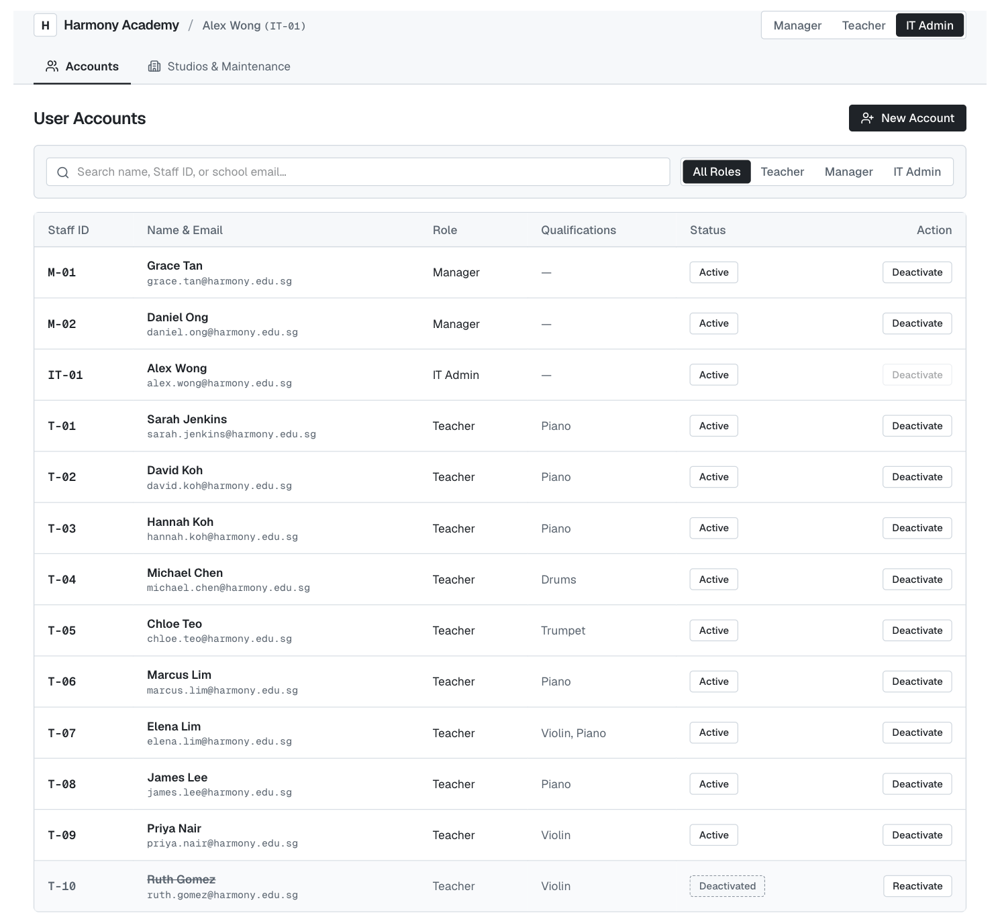
  <em style="color: #666; font-size: 10pt;">Figure 5.10: IT Administrator User Accounts & Logical Soft-Deactivation</em>
</div>

<div style="text-align: center; margin: 14pt 0;">
  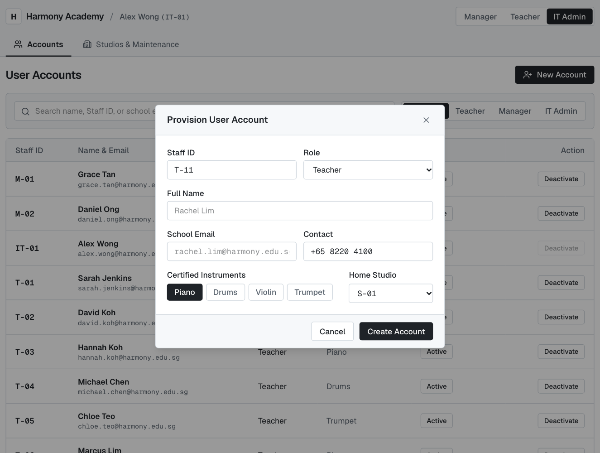
  <em style="color: #666; font-size: 10pt;">Figure 5.11: IT Administrator Account Provisioning Dialog</em>
</div>

<div style="text-align: center; margin: 14pt 0;">
  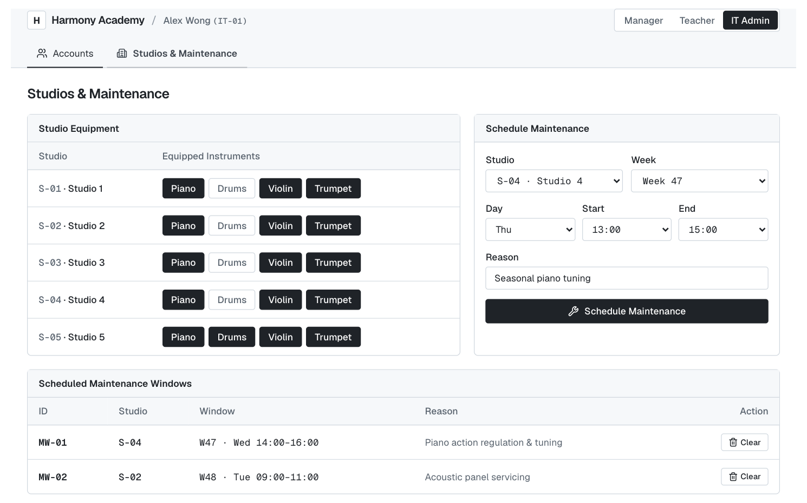
  <em style="color: #666; font-size: 10pt;">Figure 5.12: IT Administrator Studio Equipment & Maintenance Scheduler</em>
</div>

<div style="text-align: center; margin: 14pt 0;">
  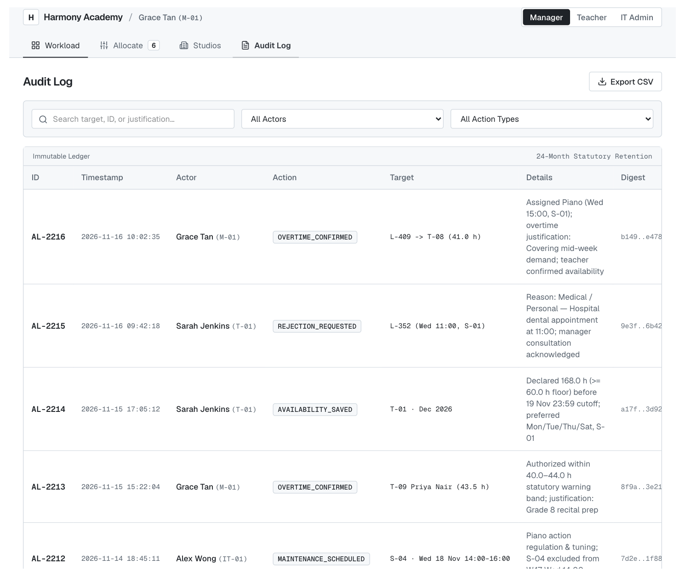
  <em style="color: #666; font-size: 10pt;">Figure 5.13: Immutable 24-Month Compliance Audit Log Console</em>
</div>

<div style="display: flex; gap: 16px; align-items: flex-start; margin: 14pt 0;">
  <div style="flex: 1.45; min-width: 0; text-align: center;">
    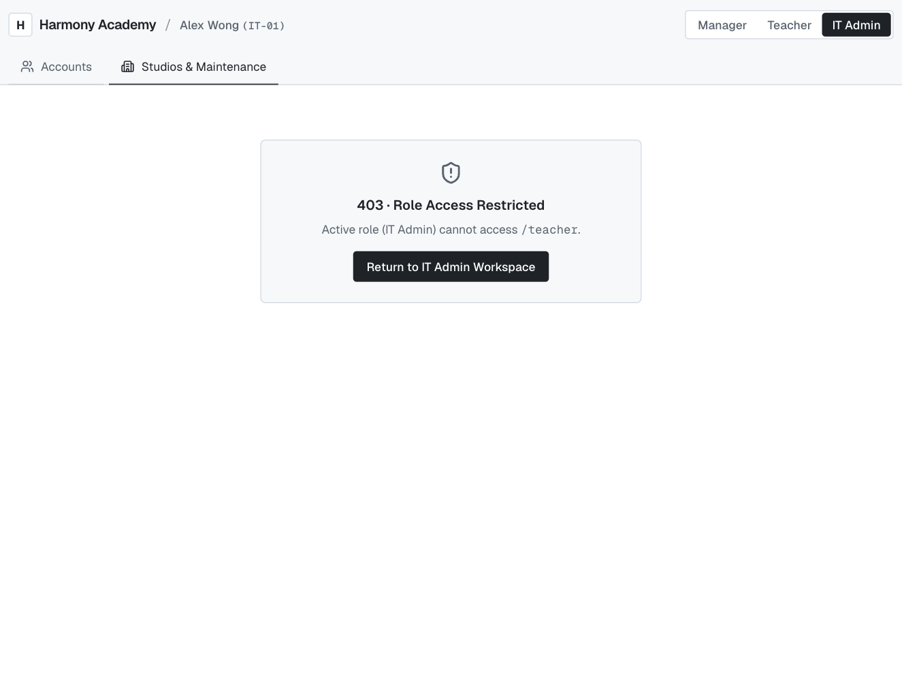
    <em style="color: #666; font-size: 10pt;">Figure 5.14: Role-Based Access Restriction (NFR-SEC-01)</em>
  </div>
  <div style="flex: 0.55; min-width: 0; text-align: center;">
    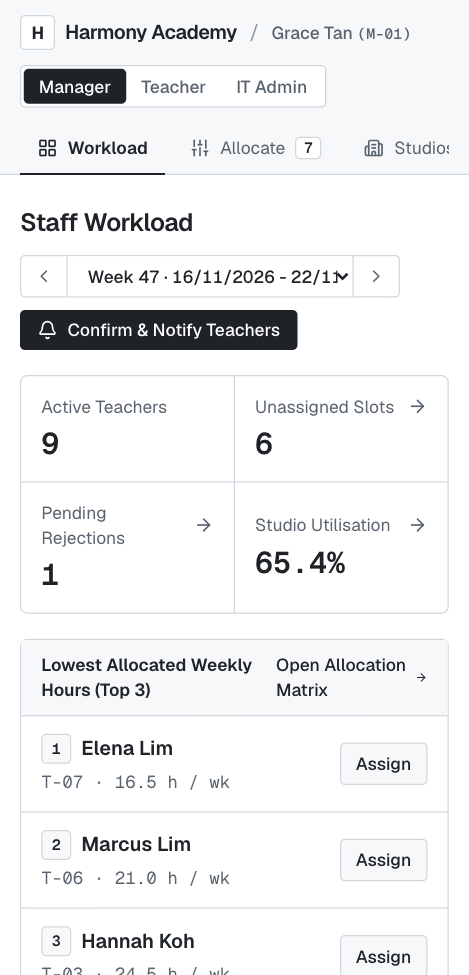
    <em style="color: #666; font-size: 10pt;">Figure 5.15: 375px Mobile Viewport (NFR-USE-01)</em>
  </div>
</div>
<div class="page-break"></div>

<div align="center">

# 6 References

</div>

[1] G. Booch, J. Rumbaugh, and I. Jacobson, *The Unified Modeling Language User Guide*, 2nd ed. Reading, MA, USA: Addison-Wesley, 2005.

[2] E. Gamma, R. Helm, R. Johnson, and J. Vlissides, *Design Patterns: Elements of Reusable Object-Oriented Software*. Reading, MA, USA: Addison-Wesley, 1994.

[3] T. J. McCabe, "A complexity measure," *IEEE Trans. Softw. Eng.*, vol. SE-2, no. 4, pp. 308–320, Dec. 1976.

[4] Ministry of Manpower Singapore, *Employment Act (Chapter 91), Part IV: Hours of Work, Rest Days and Other Conditions of Service*, Singapore Statutes Online, 2026.

[5] R. S. Pressman and B. R. Maxim, *Software Engineering: A Practitioner's Approach*, 9th ed. New York, NY, USA: McGraw-Hill, 2020.

[6] World Wide Web Consortium, *Web Content Accessibility Guidelines (WCAG) 2.2, Success Criterion 1.4.1: Use of Color*, W3C Recommendation, Oct. 2023.
