

#### INF2001 Introduction to Software Engineering

# Milestone 2: Detailed Design, Test Plan and Wireframe

### Music School Workload Allocation & Resource Scheduling System

  

##### Prepared by

##### Team P5-5

<table style="margin: 0 auto; width: 65%; border-collapse: collapse; text-align: center;">
  <thead>
    <tr>
      <th style="text-align: center; font-weight: bold; border: 1pt solid #000; padding: 6pt 16pt;">Student Name</th>
      <th style="text-align: center; font-weight: bold; border: 1pt solid #000; padding: 6pt 16pt;">Student ID</th>
    </tr>
  </thead>
  <tbody>
    <tr>
      <td style="border: 1pt solid #000; padding: 6pt 16pt;">Joseph Poon</td>
      <td style="border: 1pt solid #000; padding: 6pt 16pt;">2501079</td>
    </tr>
    <tr>
      <td style="border: 1pt solid #000; padding: 6pt 16pt;">Ryan Ke</td>
      <td style="border: 1pt solid #000; padding: 6pt 16pt;">2501911</td>
    </tr>
    <tr>
      <td style="border: 1pt solid #000; padding: 6pt 16pt;">Wei Xiang</td>
      <td style="border: 1pt solid #000; padding: 6pt 16pt;">2500686</td>
    </tr>
    <tr>
      <td style="border: 1pt solid #000; padding: 6pt 16pt;">Tan Yan Qi</td>
      <td style="border: 1pt solid #000; padding: 6pt 16pt;">2500030</td>
    </tr>
    <tr>
      <td style="border: 1pt solid #000; padding: 6pt 16pt;">Zayne Lee</td>
      <td style="border: 1pt solid #000; padding: 6pt 16pt;">2503844</td>
    </tr>
    <tr>
      <td style="border: 1pt solid #000; padding: 6pt 16pt; font-weight: bold;">Lab Group:</td>
      <td style="border: 1pt solid #000; padding: 6pt 16pt;">P5 - Team 5</td>
    </tr>
    <tr>
      <td style="border: 1pt solid #000; padding: 6pt 16pt; font-weight: bold;">Date:</td>
      <td style="border: 1pt solid #000; padding: 6pt 16pt;">20 November 2026</td>
    </tr>
  </tbody>
</table>

<h1>Table of Contents</h1>

<table style="width: 100%; border-collapse: collapse; border: none; font-size: 11pt; line-height: 1.8;">
  <tbody>
    <tr>
      <td style="border: none; padding: 2pt 0; font-weight: bold;">Non-Plagiarism Declaration</td>
      <td style="border: none; padding: 2pt 0; text-align: right; font-weight: bold;">3</td>
    </tr>
    <tr>
      <td style="border: none; padding: 2pt 0; font-weight: bold;">AI Usage</td>
      <td style="border: none; padding: 2pt 0; text-align: right; font-weight: bold;">4</td>
    </tr>
    <tr>
      <td style="border: none; padding: 2pt 0; font-weight: bold;">1 Introduction</td>
      <td style="border: none; padding: 2pt 0; text-align: right; font-weight: bold;">5</td>
    </tr>
    <tr>
      <td style="border: none; padding: 2pt 0 2pt 16pt;">1.1 Team member contributions</td>
      <td style="border: none; padding: 2pt 0; text-align: right;">5</td>
    </tr>
    <tr>
      <td style="border: none; padding: 2pt 0 2pt 16pt;">1.2 Final requirements</td>
      <td style="border: none; padding: 2pt 0; text-align: right;">5</td>
    </tr>
    <tr>
      <td style="border: none; padding: 2pt 0 2pt 16pt;">1.3 Final Class Diagram</td>
      <td style="border: none; padding: 2pt 0; text-align: right;">9</td>
    </tr>
    <tr>
      <td style="border: none; padding: 2pt 0; font-weight: bold;">2 Component Diagram</td>
      <td style="border: none; padding: 2pt 0; text-align: right; font-weight: bold;">10</td>
    </tr>
    <tr>
      <td style="border: none; padding: 2pt 0 2pt 16pt;">2.1 Component Architecture & Subsystems</td>
      <td style="border: none; padding: 2pt 0; text-align: right;">10</td>
    </tr>
    <tr>
      <td style="border: none; padding: 2pt 0 2pt 16pt;">2.2 Provided and Required Interface Contracts</td>
      <td style="border: none; padding: 2pt 0; text-align: right;">11</td>
    </tr>
    <tr>
      <td style="border: none; padding: 2pt 0 2pt 16pt;">2.3 Architectural Design Rationale</td>
      <td style="border: none; padding: 2pt 0; text-align: right;">12</td>
    </tr>
    <tr>
      <td style="border: none; padding: 2pt 0; font-weight: bold;">3 Detailed Design</td>
      <td style="border: none; padding: 2pt 0; text-align: right; font-weight: bold;">13</td>
    </tr>
    <tr>
      <td style="border: none; padding: 2pt 0 2pt 16pt;">3.1 Architecture Design</td>
      <td style="border: none; padding: 2pt 0; text-align: right;">13</td>
    </tr>
    <tr>
      <td style="border: none; padding: 2pt 0 2pt 16pt;">3.2 Detailed Design</td>
      <td style="border: none; padding: 2pt 0; text-align: right;">14</td>
    </tr>
    <tr>
      <td style="border: none; padding: 2pt 0; font-weight: bold;">4 Testing</td>
      <td style="border: none; padding: 2pt 0; text-align: right; font-weight: bold;">18</td>
    </tr>
    <tr>
      <td style="border: none; padding: 2pt 0 2pt 16pt;">4.1 White Box Testing</td>
      <td style="border: none; padding: 2pt 0; text-align: right;">18</td>
    </tr>
    <tr>
      <td style="border: none; padding: 2pt 0 2pt 16pt;">4.2 Black Box Testing</td>
      <td style="border: none; padding: 2pt 0; text-align: right;">21</td>
    </tr>
    <tr>
      <td style="border: none; padding: 2pt 0; font-weight: bold;">5 Wireframe</td>
      <td style="border: none; padding: 2pt 0; text-align: right; font-weight: bold;">26</td>
    </tr>
    <tr>
      <td style="border: none; padding: 2pt 0 2pt 16pt;">5.1 Manager Scheduling & Outlier Intelligence View</td>
      <td style="border: none; padding: 2pt 0; text-align: right;">26</td>
    </tr>
    <tr>
      <td style="border: none; padding: 2pt 0 2pt 16pt;">5.2 Allocation Matrix & Conflict Feedback View</td>
      <td style="border: none; padding: 2pt 0; text-align: right;">27</td>
    </tr>
    <tr>
      <td style="border: none; padding: 2pt 0 2pt 16pt;">5.3 Teacher Availability & Timetable Inspection View</td>
      <td style="border: none; padding: 2pt 0; text-align: right;">28</td>
    </tr>
    <tr>
      <td style="border: none; padding: 2pt 0 2pt 16pt;">5.4 Audit Log Console, Admin Configuration & Design System View</td>
      <td style="border: none; padding: 2pt 0; text-align: right;">29</td>
    </tr>
    <tr>
      <td style="border: none; padding: 2pt 0; font-weight: bold;">6 References</td>
      <td style="border: none; padding: 2pt 0; text-align: right; font-weight: bold;">31</td>
    </tr>
  </tbody>
</table>

### Non-Plagiarism Declaration

Students are not allowed to copy assessment solutions from another person or other places. It is the students’ responsibility to guarantee that their solutions are their own work. Meanwhile, the students must also ensure that their work is not accessible by others. Where such plagiarism is detected, both of the assessments involved will receive ZERO mark.

We hereby declare that:

- We fully understand and agree to the abovementioned policy.
- We did not copy any materials from others or from other places.
- We did not share our materials with others or upload to any other places for public access.
- We agree that we will not disclose any information or material of the team project to others or upload to any other places for public access.
- We agree that our project will receive Zero mark if any misalignment with the abovementioned policies is detected.

Declared by: Group P5-5

Team members:
1. Joseph Poon (2501079)
2. Ryan Ke (2501911)
3. Wei Xiang (2500686)
4. Tan Yan Qi (2500030)
5. Zayne Lee (2503844)

Date: 20 November 2026

### AI Usage

In accordance with SIT academic policy, generative AI tools were used as assistive engineering aids during Milestone 2 preparation, as summarized below:

| Document Section | Generative AI Tool | Specific Prompt Intent & Usage Scope | Human Governance, Verification & Modifications |
| :--- | :--- | :--- | :--- |
| **§1.2, §4.1 (Tables)** | Claude Sonnet 5.5 | Markdown table formatting, syntax linting, column alignment. | Replaced generic descriptions with concrete domain attributes; verified truth tables and algebraic reduction. |
| **§1.3, §2.0, §3.2 (Diagrams)** | Claude Opus 5.5 | PlantUML syntax verification, styling parameter checks. | Manually authored all component boundaries, interface contracts, and GoF Strategy structures. |
| **§2.3, §3.1 (Narrative)** | Claude Sonnet 5.5 | Phrasing refinement and technical editing. | Rewrote output to accurately reflect stakeholder interview evidence and statutory citations. |
| **§4.1, §4.2 (Testing Suite)** | Claude Opus 5.5 | Control Flow Graph edge verification and cyclomatic complexity check. | Derived non-binary 3-tier workload basis paths manually, confirmed $V(G) = 6$, and defined full-coverage test parameter specifications. |
| **§5.0 (Wireframes)** | Figma + Figwright MCP | Programmatic Figma layout generation, design token binding, and high-DPI PNG asset export. | Verified static screenshot coverage across all required UI states and traced requirements (`FR-01` to `FR-18`, `NFR-USE-02`, `NFR-COM-01`). |

Engineering Integrity Confirmation: All core business logic—including the 4-hour continuous teaching limit with mandatory 1-hour rest, instrument-equipped studio matching, monthly 19th 23:59 cutoff window, 2-stage rejection discussion lifecycle, and 3-tier workload classification (`< 40.0h` OK, `40.0h–44.0h` Warning, `> 44.0h` Overworked)—was derived directly from stakeholder interviews and manually verified against project specifications.

# 1 Introduction

### 1.1 Team member contributions

| Student Name | Student ID | Project Role | Authored Sections & Responsibilities |
| :--- | :--- | :--- | :--- |
| **Joseph Poon** | 2501079 | Lead Architect | Authored the UML 2.5 Component Diagram (§2.0), formulated Service Interface Contracts (§2.2), restructured the Final Class Diagram (§1.3), and designed the White-Box Testing Control Flow Graph (§4.1). |
| **Ryan Ke** | 2501911 | Requirements & QA Lead | Addressed M1 consultation feedback, refined master Functional and Non-Functional Requirements (§1.2), developed Black-Box Decision Table testing methodology, and derived combinatorial reduction (§4.2). |
| **Wei Xiang** | 2500686 | Detailed Design Lead | Conducted Java / Spring Boot architectural pattern analysis (§3.1), evaluated GoF design pattern trade-offs (§3.2.1), formalized Strategy Pattern implementation for candidate tie-breaking (§3.2.2), and authored Observer pattern specifications (§3.2.3). |
| **Tan Yan Qi** | 2500030 | Test & Verification Lead | Formulated interface method contracts for inter-component communication (§2.2), validated non-binary 3-tier basis path coverage and cyclomatic complexity mathematics (§4.1), and specified full-coverage test case parameters. |
| **Zayne Lee** | 2503844 | Operations Lead | Developed architectural design rationale (§2.3), verified alignment between requirements, use cases, and static wireframe views (§5.0), and compiled the compliance audit trail specification. |

### 1.2 Final requirements
Following the Milestone 1 consultation, the requirement baseline was refined to eliminate scope creep, resolve vague terminology, and enforce atomic specifications meeting the 7 traits of good requirements (cohesive, complete, consistent, atomic, traceable, unambiguous, verifiable).

The bilateral peer lesson swap feature (`FR-11` in M1) and intermediate draft schedule transition screens were removed from the active system scope to ensure sufficiency. Resolving lesson conflicts remains the operational responsibility of the School Manager through the job rejection discussion workflow, and confirming lesson allocations directly triggers teacher notifications. Because staff work allocation is assigned monthly, each slot carries a predetermined studio location that is displayed directly to teachers and managers. Teacher weekly workload is evaluated across three non-binary tiers: below 40.0 hours (`OK`), 40.0 to 44.0 hours (`Warning` / authorized overtime), and above 44.0 hours (`Overworked` / statutory ceiling breach). To ensure managers have sufficient scheduling flexibility, instructors must declare at least 60.0 hours of monthly availability.

#### Table 1.1: Final Functional Requirements Specification

| ID | Priority | Functional Requirement Specification | Updates from M1 |
| :--- | :---: | :--- | :--- |
| **FR-01** | Must | The system shall display each teacher's monthly work allocation and assigned studio location upon lesson confirmation. | Replaced running weekly/monthly hours calculation with monthly allocation and assigned studio location display. |
| **FR-02** | Must | The system shall sort and display the top 3 teachers with the lowest allocated hours on the manager dashboard and classify weekly teacher workload across three tiers: below 40.0 hours (`OK`), 40.0 to 44.0 hours (`Warning`), and above 44.0 hours (`Overworked`). | Adopted 3-tier non-binary workload classification; moved visual color styling to `NFR-USE-02`. |
| **FR-03** | Must | The system shall allow managers to manually allocate unassigned 30-minute lesson slots to eligible teachers for a target week. | |
| **FR-04** | Must | The system shall display up to 3 candidate teachers side-by-side during allocation, showing each candidate's current workload, teaching preferences, and assigned studio location for the specified date. | |
| **FR-05** | Should | The system shall rank eligible candidate teachers by remaining weekly capacity below the 40.0-hour threshold and preferred teaching day match. | Defined workload ranking metric and replaced vague teaching condition terms. |
| **FR-06** | Must | The system shall allow teachers to submit and edit recurring 30-minute availability slots up to 1 month ahead until 23:59 on the 19th of each month, enforcing a minimum declaration of 60.0 hours. | Added minimum 60.0-hour monthly availability requirement. |
| **FR-07** | Must | The system shall allow teachers to specify preferred teaching days, preferred studio ID, and consecutive lesson block limits of up to 4.0 continuous hours followed by a minimum 1.0-hour rest break within their submitted availability window. | Defined consecutive teaching block and rest break rules within declared availability. |
| **FR-08** | Must | The system shall provide teachers with a personal weekly schedule displaying confirmed lessons, assigned studio locations, and enrolled student details. | Replaced contact masking specification with enrolled student details. |
| **FR-09** | Must | The system shall allow teachers to reject an assigned lesson slot by recording a rejection request flagged for discussion with the manager prior to re-allocation. | |
| **FR-10** | Should | The system shall flag availability changes submitted after the 19th cutoff for manager review. | |
| **FR-11** | Should | The system shall allow IT administrators to schedule studio maintenance periods and exclude studios under maintenance from lesson allocation. | Removed peer lesson swap (`FR-11` in M1) due to scope creep. |
| **FR-12** | Should | The system shall allow managers to reassign scheduled lessons of an absent teacher to qualified and available substitute teachers. | Generalized from batch reassignment to single-slot substitute reassignment. |
| **FR-13** | Must | The system shall allow IT administrators to provision user accounts and perform logical account deactivations for Teachers, Managers, and IT Administrators. | |
| **FR-14** | Must | The system shall allow IT administrators to configure studio instrument equipment for Studios 1 to 5 and restrict lesson allocations to studios equipped with the required instrument. | Generalized studio restriction to match lesson instrument against studio equipment. |
| **FR-15** | Must | The system shall notify assigned teachers when lesson allocations are confirmed for a weekly schedule. | Removed intermediate draft schedule state transitions. |
| **FR-16** | Should | The system shall calculate booked versus available studio hours across the 86 weekly operating hours and generate studio utilisation reports for school administration. | |
| **FR-17** | Must | The system shall evaluate teacher weekly working hours across three tiers—acceptable (`< 40.0` hours), overtime warning (`40.0–44.0` hours), and overworked statutory breach (`> 44.0` hours under Employment Act Part IV)—and require manager confirmation for allocations in the warning tier. | Consolidated overtime warning and statutory limit checks into a single 3-tier model. |
| **FR-18** | Must | The system shall append an immutable audit log record for every lesson allocation, overtime confirmation, rejection update, and administrative configuration change, and allow managers to inspect the audit trail. | Added explicit audit trail inspection capability. |

#### Table 1.2: Final Non-Functional Requirements Specification

| NFR ID | Category | Non-Functional Requirement Specification | Operational & Statutory Justification |
| :--- | :--- | :--- | :--- |
| **NFR-USE-01** | Usability | The system shall render all web interfaces across desktop and mobile viewports (375px to 1920px) without horizontal scrolling. | Enables mobile timetable inspection for teachers and desktop allocation for managers. |
| **NFR-USE-02** | Usability | The system shall display teacher weekly workload status using three visual tiers paired with text badges: Green `OK` (`< 40.0h`), Amber `Warning` (`40.0h–44.0h`), and Red `Overworked` (`> 44.0h`). | Aligns UI visual indicators with the 3-tier workload classification and WCAG 2.2 AA accessibility rules. |
| **NFR-PER-01** | Performance | The system shall complete initial page rendering within 1.5 seconds under a concurrent load of 20 active users. | Ensures responsive scheduling operations during monthly allocation cycles. |
| **NFR-PER-02** | Performance | The system shall evaluate candidate eligibility and clash constraints within 300 milliseconds of slot selection. | Delivers immediate decision support during manual lesson slot allocation. |
| **NFR-REL-01** | Reliability | The system shall maintain at least 99.5% uptime during the monthly scheduling window from the 19th to the 24th of each calendar month. | Prevents scheduling bottlenecks around the monthly availability cutoff. |
| **NFR-REL-02** | Reliability | The system shall execute account and lesson removals exclusively via logical status flags without physical record deletion. | Preserves historical referential integrity for audit and utilisation reporting. |
| **NFR-SEC-01** | Security | The system shall enforce role-based access control restricting teachers to their own schedules and restricting system configuration panels to IT administrators. | Protects staff schedules and prevents unauthorized administrative changes. |
| **NFR-COM-01** | Compliance | The system shall retain immutable audit log records for at least 24 calendar months. | Satisfies Ministry of Manpower statutory employment record retention requirements. |
| **NFR-COM-02** | Compliance | The system shall enforce the 44.0-hour weekly maximum under Employment Act Part IV and record all authorized overtime allocations between 40.0 and 44.0 hours. | Ensures statutory labor compliance across all teaching assignments. |

### 1.3 Final Class Diagram

The final class diagram incorporates all structural updates from Milestone 1 and Milestone 2, including explicit interface realizations, Java / Spring Boot service contracts, teacher workload and assigned location attributes, and design pattern roles.

  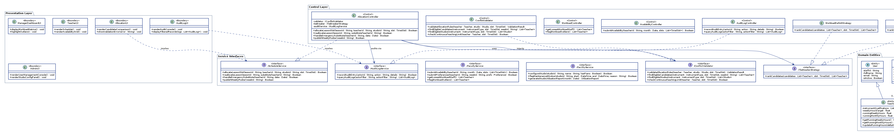
  <em style="color: #666; font-size: 10pt;">Figure 1.1: Final Class Diagram with Service Interfaces, Controllers, Strategies, and Domain Entities</em>

# 2 Component Diagram

### 2.1 Component Architecture & Subsystems

The component diagram partitions the **Java 21 and Spring Boot** application into three primary internal layers enclosed within the system boundary, exposing clean Spring service interfaces and isolating external infrastructure gateways.

  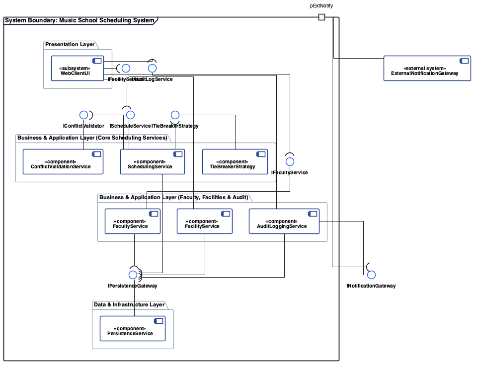
  <em style="color: #666; font-size: 10pt;">Figure 2.1: UML 2.5 Component Diagram for Music School Scheduling System</em>

The system architecture comprises seven primary components implemented as modular Spring Boot components:

1. WebClientUI: Presentation subsystem encapsulating boundary controllers (`AllocationUI`, `ManagerDashboardUI`, `TeacherUI`, `AdminUI`, `AuditLogUI`). Operates strictly as a service consumer invoking provided Java service interfaces.
2. SchedulingService: Central Spring `@Service` application controller orchestrating lesson slot allocation, substitute reassignment, rejection review, and teacher schedule notification.
3. ConflictValidationService: Domain validation component executing multi-constraint checks across instrument certifications, room instrument compatibility, 4.0-hour continuous teaching limits, and the 3-tier weekly workload model (`< 40.0h`, `40.0h–44.0h`, `> 44.0h`).
4. FacultyService: Manages teacher profiles, assigned studio locations, availability grids, monthly submission windows, and workload calculations.
5. FacilityService: Manages physical room metadata for Studios 1 to 5, studio instrument configurations, studio utilisation metrics, and scheduled studio maintenance periods.
6. AuditLoggingService: Centralized regulatory logging service maintaining append-only historical ledgers and compliance query tools via Spring Data JPA.
7. ExternalNotificationGateway: Infrastructure adapter situated outside the system boundary, interfacing via boundary port `pExtNotify` to dispatch automated timetable alerts to assigned teachers.

### 2.2 Provided and Required Interface Contracts

Every exposed interface realizes strict method contracts ensuring compile-time safety and decoupled communication across component boundaries:

`IScheduleService` (Provided by SchedulingService, Required by WebClientUI):
- `allocateLessonSlot(lessonId: String, teacherId: String, studioId: String, slot: TimeSlot): Boolean`
- `reallocateLesson(lessonId: String, substituteTeacherId: String): Boolean`
- `notifyAssignedTeachers(weekId: String): Boolean`

`IConflictValidator` (Provided by ConflictValidationService, Required by SchedulingService):
- `validateAllocationRules(teacher: Teacher, studio: Studio, slot: TimeSlot): ValidationResult`
- `findEligibleCandidates(instrument: InstrumentType, slot: TimeSlot, weekId: String): List<Teacher>`
- `checkContinuousTeachingLimit(teacher: Teacher, slot: TimeSlot): Boolean`

`IFacultyService` (Provided by FacultyService, Required by WebClientUI, SchedulingService, ConflictValidationService):
- `submitAvailability(teacherId: String, month: Date, slots: List<TimeSlot>): Boolean`
- `getLowestWorkloadStaff(): List<Teacher>`
- `getTeacher(teacherId: String): Teacher`

`IFacilityService` (Provided by FacilityService, Required by WebClientUI, ConflictValidationService):
- `configureStudio(studioId: String, name: String, hasPiano: Boolean): Boolean`
- `flagMaintenanceWindow(studioId: String, start: DateTime, end: DateTime, reason: String): Boolean`
- `getStudio(studioId: String): Studio`

`IAuditLogService` (Provided by AuditLoggingService, Required by WebClientUI, SchedulingService):
- `recordAuditEntry(actorId: String, action: String, details: String): Boolean`
- `queryAuditLogs(weekId: String): List<AuditLog>`

`ITieBreakerStrategy` (Provided by TieBreakerStrategy, Required by SchedulingService):
- `rankCandidates(candidates: List<Teacher>, slot: TimeSlot): List<Teacher>`

### 2.3 Architectural Design Rationale

The software architecture prioritizes three primary quality attributes derived from stakeholder elicitation:

1. **Modifiability:** Music academies periodically revise operational policies, including statutory overtime thresholds, instrument qualifications, and rest break durations. To prevent these policy changes from rippling across the codebase, the architecture isolates constraint verification inside `ConflictValidationService` and candidate ranking inside `ITieBreakerStrategy`, enabling developers to update scheduling rules while keeping presentation views and persistence schemas unchanged.
2. **Reliability & Data Integrity:** Prior manual spreadsheet workflows frequently produced room double-bookings and unrecorded overtime because assignments were entered without automated verification. By routing every scheduling request through `IScheduleService`, the architecture enforces mandatory conflict validation before any database commit and immediately delegates state mutations to `IAuditLogService`, guaranteeing conflict-free schedules and a complete 24-month statutory audit trail.
3. **Usability & Operational Responsiveness:** School managers must evaluate and assign dozens of weekly lesson slots under tight monthly deadlines, which requires rapid feedback during candidate comparison. Separating read-optimized candidate filtering (`IConflictValidator`) from full schedule persistence allows the system to evaluate eligibility constraints in memory within 300 milliseconds, providing immediate conflict indicators on the allocation screen.

# 3 Detailed Design

### 3.1 Architecture Design

The system implements a strict Hierarchical Layered Architecture in **Java 21 with Spring Boot**, organized into three closed tiers: Presentation Layer (Spring MVC / Thymeleaf Web Boundary), Business and Application Layer (Spring `@Service` Domain Controllers and Strategies), and Data and Infrastructure Layer (Spring Data JPA Repositories with PostgreSQL and SMTP/SMS Gateways).

  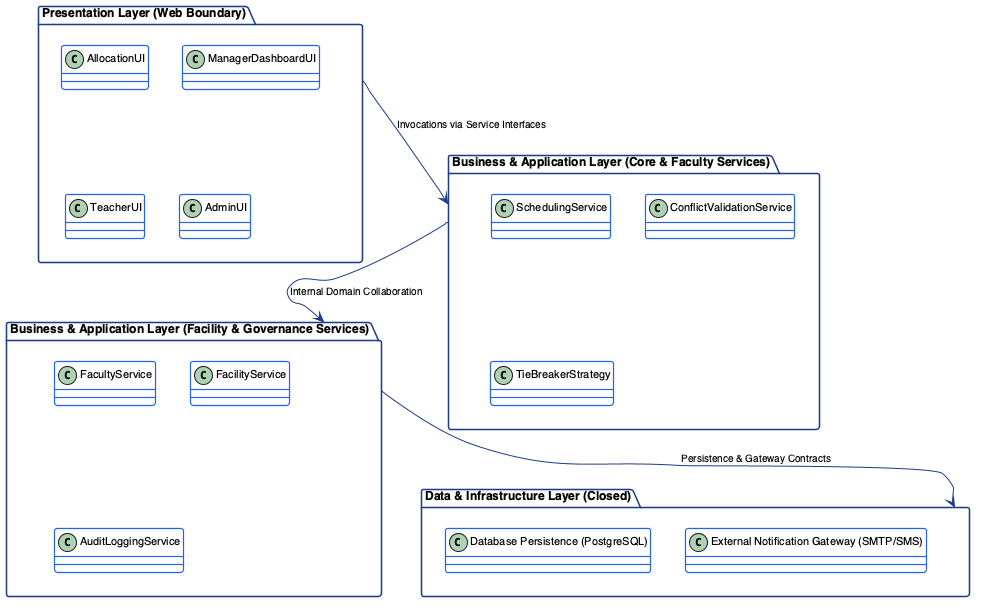
  <em style="color: #666; font-size: 10pt;">Figure 3.1: 3-Tier Hierarchical Layered Architecture for Music School Scheduling System</em>

In accordance with closed layering rules, layer-skipping is strictly prohibited. Requests flow sequentially downward through the business controllers, and domain data returns synchronously back through the calling hierarchy.
Architectural Pattern Comparison:

| Evaluated Architecture | Structural Characteristics | Suitability Analysis for Scheduling System |
| :--- | :--- | :--- |
| Hierarchical Layered (Selected) | Partitions system horizontally into closed Presentation, Business, and Persistence layers. Each layer depends only on the layer immediately below it. | Selected: Enforces clean separation of concerns, guarantees that business rules and statutory overtime checks cannot be bypassed by UI components, and simplifies unit test isolation. |
| Model-View-Controller (MVC) | Separates UI rendering (View) and user inputs (Controller) from domain entities (Model). | Adopted within Presentation Tier: Boundary views capture user inputs and delegate to controllers, but MVC alone lacks formal boundaries for complex domain validation services. |
| Microservices Architecture | Distributes application logic across independent, network-partitioned service processes. | Rejected: Introduces unnecessary network latency, distributed transaction complexity, and DevOps overhead for an academy with 9 teachers and 5 studios. |

### 3.2 Detailed Design

#### 3.2.1 Design Pattern Evaluation & Trade-off Analysis

To resolve detailed design problems within the scheduling core, four Gang of Four (GoF) patterns were evaluated against operational requirements:

| Evaluated Pattern | Target Operational Problem | Architectural Trade-offs & Analysis | Selection Outcome |
| :--- | :--- | :--- | :--- |
| Strategy Pattern | Dynamic candidate teacher ranking across competing operational heuristics (workload deficit vs preference match). | Pros: Decouples candidate sorting algorithms from allocation controllers; satisfies Open/Closed Principle. Cons: Increases class count slightly. Verdict: Long-term extensibility outweighs minimal class boilerplate. | Selected (Implemented) |
| Observer Pattern | Decoupling schedule publication events from automated email, SMS, and dashboard notification dispatch. | Pros: Broadcasts schedule publication events to multiple communication channels without coupling scheduling controllers to notification protocols. Cons: Unsubscribing listeners requires explicit lifecycle management to avoid memory retention. | Selected (Implemented) |
| Factory Method | Instantiating specialized User accounts (Teacher, Manager, ITAdministrator) during onboarding. | Pros: Encapsulates role creation. Cons: Account onboarding occurs infrequently; adds unnecessary abstraction over simple constructors. | Evaluated (Alternative) |
| Singleton Pattern | Providing global access to the scheduling engine or system configuration registry. | Pros: Single point of access. Cons: Introduces global state, tightly couples callers to concrete implementations, and hinders test isolation. | Evaluated (Rejected) |

#### 3.2.2 Strategy Pattern (Selected)

Operational Problem: When allocating an unassigned lesson, multiple teachers often satisfy all hard eligibility constraints (qualified, available, within 4.0-hour continuous teaching limits, and at or below the 44.0-hour cap). The system must rank these candidates to guide manager selection. Under nominal operations, management prioritizes faculty equity by ranking teachers by remaining capacity below the 40.0-hour threshold. In specialized cases, management prioritizes teacher satisfaction by ranking candidates by preferred teaching days and studio assignments.

Hardcoding this ranking logic into `AllocationController` violates the Open/Closed Principle (OCP) and Single Responsibility Principle (SRP). Adding new ranking heuristics requires modifying and recompiling core scheduling classes. The Strategy Pattern decouples algorithmic ranking from scheduling orchestration.

Structural Template:

  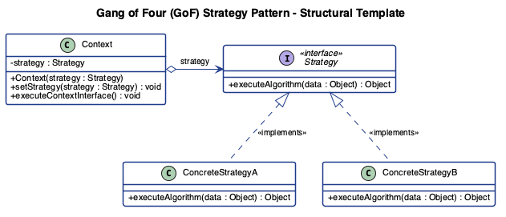
  <em style="color: #666; font-size: 10pt;">Figure 3.2: Gang of Four Strategy Pattern Standard Structural Template</em>

Before Pattern Implementation:

  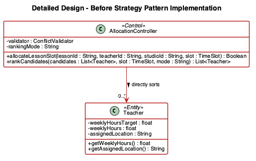
  <em style="color: #666; font-size: 10pt;">Figure 3.3: Class Excerpt Before Strategy Implementation</em>

After Strategy Pattern Implementation:

  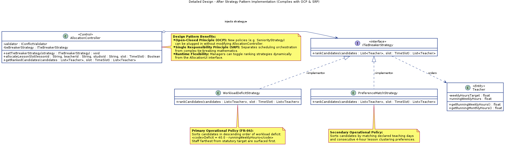
  <em style="color: #666; font-size: 10pt;">Figure 3.4: Class Excerpt After Strategy Implementation</em>

In this refactored structure, `AllocationController` acts as the Context, holding a reference to the `ITieBreakerStrategy` interface. Concrete strategies `WorkloadDeficitStrategy` and `PreferenceMatchStrategy` encapsulate independent sorting algorithms. When managers toggle ranking preferences in `AllocationUI`, the controller dynamically swaps the active strategy instance without modifying orchestration code.

#### 3.2.3 Observer Pattern (Selected)

Operational Problem: When a manager confirms weekly lesson allocations and notifies assigned teachers (`UC-05` / `FR-15`), multiple decoupled subsystems require notification: assigned teachers must receive schedule alerts, administrators require audit event records, and dashboard metrics must synchronize. Direct calls from `AllocationController` to external mail or SMS APIs tightly couple core scheduling logic to communication protocols.

Applying the Observer Pattern establishes a one-to-many dependency, allowing `AllocationController` (Subject) to broadcast state transitions to registered listeners (Observers) without coupling to concrete notification implementations.

Structural Template:

  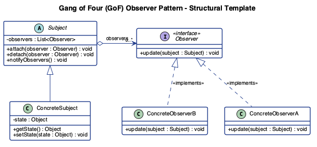
  <em style="color: #666; font-size: 10pt;">Figure 3.5: Gang of Four Observer Pattern Standard Structural Template</em>

After Observer Pattern Implementation:

  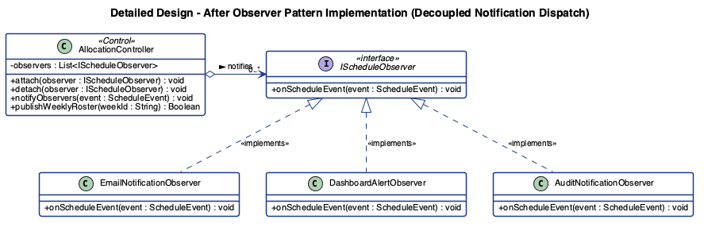
  <em style="color: #666; font-size: 10pt;">Figure 3.6: Class Excerpt After Observer Implementation</em>

In this structure, `AllocationController` maintains an internal subscriber list through the `IScheduleObserver` interface. When `notifyAssignedTeachers()` executes, it iterates through observers invoking `onScheduleEvent()`. Concrete subscribers `EmailNotificationObserver`, `DashboardAlertObserver`, and `AuditNotificationObserver` handle delivery independently.

# 4 Testing

### 4.1 White Box Testing

White-box testing evaluates the internal logic of `ConflictValidator.findEligibleCandidates(instrument, slot, weekId)` using Control Flow Testing and Basis Path derivation to achieve 100% statement coverage and 100% branch coverage.

#### 4.1.1 Control Flow Graph

Node 5 models the weekly workload check as a non-binary 3-way decision branch corresponding to the three workload tiers:
- **Tier 1 (`< 40.0h`):** Projected weekly hours remain below 40.0 hours (`Node 6`); candidate status is set to `OK` and the candidate is added to the eligible list.
- **Tier 2 (`40.0h–44.0h`):** Projected weekly hours fall between 40.0 and 44.0 hours (`Node 7`); candidate status is set to `WARNING` and the candidate is added to the eligible list.
- **Tier 3 (`> 44.0h`):** Projected weekly hours exceed 44.0 hours (`Node 8`); candidate status is set to `OVERWORKED` and the candidate is excluded.

  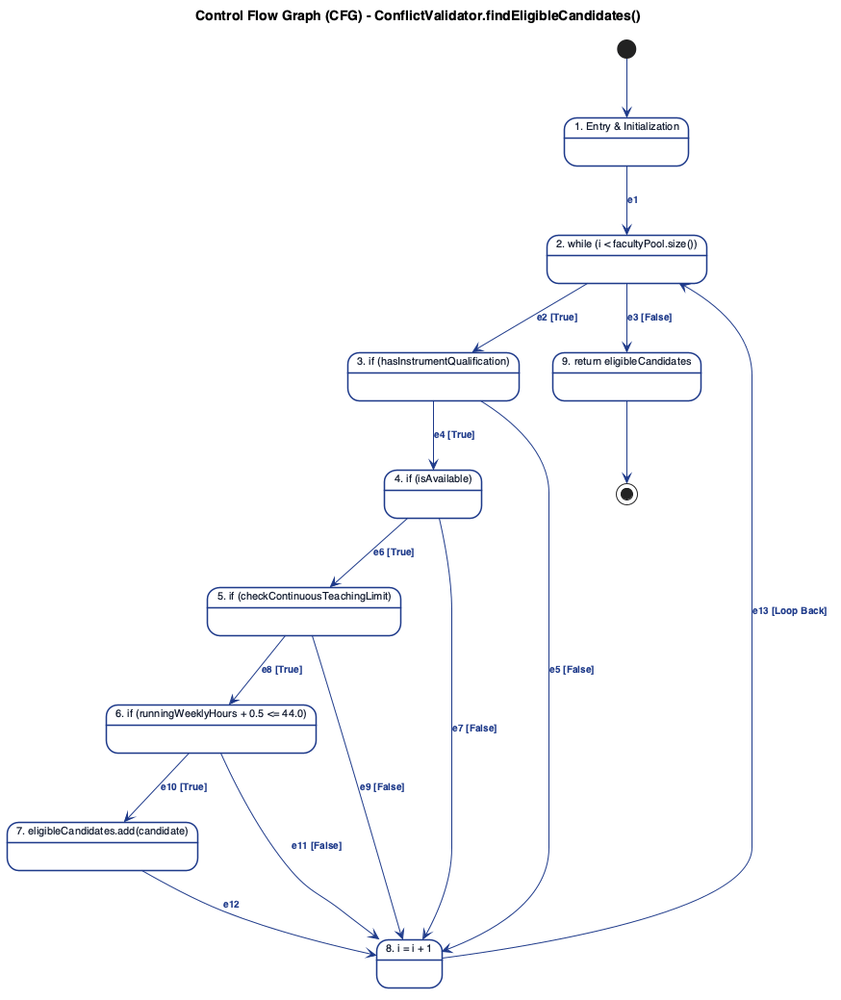
  <em style="color: #666; font-size: 10pt;">Figure 4.1: Control Flow Graph for ConflictValidator.findEligibleCandidates()</em>

#### 4.1.2 Cyclomatic Complexity

Cyclomatic complexity $M$ defines the number of linearly independent paths through the Control Flow Graph:

$$M = E - N + 2P$$

- $E = 14$ edges
- $N = 10$ nodes
- $P = 1$ connected component

$$M = 14 - 10 + 2(1) = 6$$

#### 4.1.3 Basis Paths

Following the baseline-and-flip method across the 6 linearly independent paths:

1. **Path 1 (Baseline — Tier 1 `< 40.0h`):** `1 - 2 - 3 - 4 - 5 - 6 - 9 - 2 - 10`
2. **Path 2 (Flip Node 5 to Tier 2 `40.0h–44.0h`):** `1 - 2 - 3 - 4 - 5 - 7 - 9 - 2 - 10`
3. **Path 3 (Flip Node 5 to Tier 3 `> 44.0h`):** `1 - 2 - 3 - 4 - 5 - 8 - 9 - 2 - 10`
4. **Path 4 (Flip Node 4 — Continuous Limit Exceeded):** `1 - 2 - 3 - 4 - 9 - 2 - 10`
5. **Path 5 (Flip Node 3 — Unqualified or Unavailable):** `1 - 2 - 3 - 9 - 2 - 10`
6. **Path 6 (Flip Node 2 — Empty Faculty Pool):** `1 - 2 - 10`

#### 4.1.4 White-Box Test Cases

#### Table 4.1: White-Box Test Cases for `findEligibleCandidates()`

| Test ID | Basis Path | Input Parameters | Projected Weekly Hours | Expected Output |
| :--- | :---: | :--- | :---: | :--- |
| **TC-WB-01** | Path 1 | `instrument`: `PIANO` `slot`: `Tue 14:00–14:30` `staffId`: `"T-01"` `qualifications`: `[PIANO]` `isAvailable`: `true` `continuousHours`: `3.5h` `weeklyHours`: `39.0h` | `39.5h` | Candidate `"T-01"` returned with `status = OK`. |
| **TC-WB-02A** | Path 2 | `instrument`: `PIANO` `slot`: `Tue 14:00–14:30` `staffId`: `"T-02"` `qualifications`: `[PIANO]` `isAvailable`: `true` `continuousHours`: `2.0h` `weeklyHours`: `39.5h` | `40.0h` | Candidate `"T-02"` returned with `status = WARNING` (lower boundary of warning tier). |
| **TC-WB-02B** | Path 2 | `instrument`: `PIANO` `slot`: `Tue 14:00–14:30` `staffId`: `"T-03"` `qualifications`: `[PIANO]` `isAvailable`: `true` `continuousHours`: `1.5h` `weeklyHours`: `43.5h` | `44.0h` | Candidate `"T-03"` returned with `status = WARNING` (upper boundary of warning tier). |
| **TC-WB-03** | Path 3 | `instrument`: `PIANO` `slot`: `Tue 14:00–14:30` `staffId`: `"T-04"` `qualifications`: `[PIANO]` `isAvailable`: `true` `continuousHours`: `1.0h` `weeklyHours`: `44.0h` | `44.5h` | Candidate excluded with `status = OVERWORKED`; returns empty list. |
| **TC-WB-04** | Path 4 | `instrument`: `PIANO` `slot`: `Tue 14:00–14:30` `staffId`: `"T-05"` `qualifications`: `[PIANO]` `isAvailable`: `true` `continuousHours`: `4.0h` `weeklyHours`: `25.0h` | `25.5h` | Candidate excluded at Node 4 (`4.5h > 4.0h` continuous limit); returns empty list. |
| **TC-WB-05A** | Path 5 | `instrument`: `PIANO` `slot`: `Tue 14:00–14:30` `staffId`: `"T-06"` `qualifications`: `[VIOLIN]` `isAvailable`: `true` `continuousHours`: `1.0h` `weeklyHours`: `20.0h` | `20.5h` | Candidate excluded at Node 3 (unqualified); returns empty list. |
| **TC-WB-05B** | Path 5 | `instrument`: `PIANO` `slot`: `Tue 14:00–14:30` `staffId`: `"T-07"` `qualifications`: `[PIANO]` `isAvailable`: `false` `continuousHours`: `1.0h` `weeklyHours`: `20.0h` | `20.5h` | Candidate excluded at Node 3 (unavailable); returns empty list. |
| **TC-WB-06** | Path 6 | `instrument`: `PIANO` `slot`: `Tue 14:00–14:30` `facultyPool`: `[]` | N/A | Loop bypassed at Node 2; returns empty list. |

### 4.2 Black Box Testing

Black-box testing evaluates `SchedulingService.allocateLessonSlot(lessonId, teacherId, studioId, slot)` using Decision Table Testing and Boundary Value Analysis.

#### 4.2.1 Causes, Effects, and Combination Count

Table 4.2 defines the input causes and output effects for lesson allocation. Cause `C4` has three possible values corresponding to the teacher's projected weekly workload tier (`< 40.0h`, `40.0h–44.0h`, `> 44.0h`), while `C1`, `C2`, `C3`, and `C5` are binary (`Y, N`):

$$\text{Total Combinations} = \prod_{i=1}^{5} V_i = 2 \times 2 \times 2 \times 3 \times 2 = 48 \text{ combinations}$$

#### Table 4.2: Complete Decision Table (48 Combinations Grouped by Indifferent States)

| Causes | Values | 1–24 | 25–36 | 37–42 | 43–44 | 45 | 46 | 47 | 48 |
| :--- | :--- | :---: | :---: | :---: | :---: | :---: | :---: | :---: | :---: |
| **C1: Teacher Qualified** | Y, N | N | Y | Y | Y | Y | Y | Y | Y |
| **C2: Teacher Available** | Y, N | Y, N | N | Y | Y | Y | Y | Y | Y |
| **C3: Continuous Hours $\le 4.0\text{h}$** | Y, N | Y, N | Y, N | N | Y | Y | Y | Y | Y |
| **C4: Projected Weekly Workload** | `< 40h`, `40–44h`, `> 44h` | Any | Any | Any | `> 44h` | `40–44h` | `< 40h` | `40–44h` | `< 40h` |
| **C5: Studio Valid & Available** | Y, N | Y, N | Y, N | Y, N | Y, N | N | N | Y | Y |
| **Effects** | | | | | | | | | |
| **E1: Confirm Allocation (`OK`)** | | | | | | | | | X |
| **E2: Overtime Warning Prompt** | | | | | | | | X | |
| **E3: Reject (Unqualified)** | | X | | | | | | | |
| **E4: Reject (Unavailable)** | | | X | | | | | | |
| **E5: Reject (Continuous Limit)** | | | | X | | | | | |
| **E6: Reject (Overworked `> 44h`)** | | | | | X | | | | |
| **E7: Reject (Studio Conflict)** | | | | | | X | X | | |

#### 4.2.2 Reduced Decision Table

Collapsing indifferent combinations (`-`) where upstream validation failures determine the outcome yields 7 reduced decision rules:

#### Table 4.3: Reduced Decision Table

| Causes | Values | R1 (1–24) | R2 (25–36) | R3 (37–42) | R4 (43–44) | R5 (45–46) | R6 (47) | R7 (48) |
| :--- | :--- | :---: | :---: | :---: | :---: | :---: | :---: | :---: |
| **C1: Teacher Qualified** | Y, N | N | Y | Y | Y | Y | Y | Y |
| **C2: Teacher Available** | Y, N | - | N | Y | Y | Y | Y | Y |
| **C3: Continuous Hours $\le 4.0\text{h}$** | Y, N | - | - | N | Y | Y | Y | Y |
| **C4: Projected Weekly Workload** | `< 40h`, `40–44h`, `> 44h` | - | - | - | `> 44h` | `< 40h`, `40–44h` | `40–44h` | `< 40h` |
| **C5: Studio Valid & Available** | Y, N | - | - | - | - | N | Y | Y |
| **Effects** | | | | | | | | |
| **E1: Confirm Allocation (`OK`)** | | | | | | | | X |
| **E2: Overtime Warning Prompt** | | | | | | | X | |
| **E3: Reject (Unqualified)** | | X | | | | | | |
| **E4: Reject (Unavailable)** | | | X | | | | | |
| **E5: Reject (Continuous Limit)** | | | | X | | | | |
| **E6: Reject (Overworked `> 44h`)** | | | | | X | | | |
| **E7: Reject (Studio Conflict)** | | | | | | X | | |

#### 4.2.3 Black-Box Test Cases

#### Table 4.4: Black-Box Test Cases for `allocateLessonSlot()`

| Test ID | Rule | Test Data / Input Parameters | Expected Result |
| :--- | :---: | :--- | :--- |
| **TC-BB-01** | R1 | `lessonId`: `"L-101"` `instrument`: `DRUMS` `teacherId`: `"T-01"` (`qualifications`: `[PIANO]`) `isAvailable`: `true` `continuousHours`: `1.0h` `weeklyHours`: `22.0h` (projected `22.5h`) `studioId`: `"S-05"` (Drum-equipped, Free) | Allocation rejected (`E3`: Teacher not qualified for instrument). |
| **TC-BB-02** | R2 | `lessonId`: `"L-102"` `instrument`: `PIANO` `teacherId`: `"T-02"` (`qualifications`: `[PIANO]`) `isAvailable`: `false` `continuousHours`: `1.0h` `weeklyHours`: `22.0h` (projected `22.5h`) `studioId`: `"S-01"` (Piano-equipped, Free) | Allocation rejected (`E4`: Teacher unavailable for selected slot). |
| **TC-BB-03** | R3 | `lessonId`: `"L-103"` `instrument`: `PIANO` `teacherId`: `"T-03"` (`qualifications`: `[PIANO]`) `isAvailable`: `true` `continuousHours`: `4.0h` (projected `4.5h`) `weeklyHours`: `28.0h` (projected `28.5h`) `studioId`: `"S-01"` (Piano-equipped, Free) | Allocation rejected (`E5`: Continuous 4.0h teaching limit exceeded). |
| **TC-BB-04** | R4 | `lessonId`: `"L-104"` `instrument`: `PIANO` `teacherId`: `"T-04"` (`qualifications`: `[PIANO]`) `isAvailable`: `true` `continuousHours`: `1.5h` `weeklyHours`: `44.0h` (projected `44.5h`) `studioId`: `"S-01"` (Piano-equipped, Free) | Allocation rejected (`E6`: Teacher overworked, exceeds 44.0h statutory cap). |
| **TC-BB-05A** | R5 | `lessonId`: `"L-105"` `instrument`: `PIANO` `teacherId`: `"T-05"` (`qualifications`: `[PIANO]`) `isAvailable`: `true` `continuousHours`: `1.0h` `weeklyHours`: `30.0h` (projected `30.5h`) `studioId`: `"S-03"` (Scheduled Maintenance Period) | Allocation rejected (`E7`: Studio unavailable due to scheduled maintenance). |
| **TC-BB-05B** | R5 | `lessonId`: `"L-106"` `instrument`: `DRUMS` `teacherId`: `"T-06"` (`qualifications`: `[DRUMS]`) `isAvailable`: `true` `continuousHours`: `1.0h` `weeklyHours`: `30.0h` (projected `30.5h`) `studioId`: `"S-01"` (Piano-only Studio, Free) | Allocation rejected (`E7`: Studio lacks required drum equipment). |
| **TC-BB-06A** | R6 | `lessonId`: `"L-107"` `instrument`: `PIANO` `teacherId`: `"T-07"` (`qualifications`: `[PIANO]`) `isAvailable`: `true` `continuousHours`: `2.0h` `weeklyHours`: `39.5h` (projected `40.0h`) `studioId`: `"S-02"` (Piano-equipped, Free) | Overtime warning triggered at `40.0h` lower boundary (`E2`); confirmed after manager approval. |
| **TC-BB-06B** | R6 | `lessonId`: `"L-108"` `instrument`: `PIANO` `teacherId`: `"T-07"` (`qualifications`: `[PIANO]`) `isAvailable`: `true` `continuousHours`: `2.5h` `weeklyHours`: `43.5h` (projected `44.0h`) `studioId`: `"S-02"` (Piano-equipped, Free) | Overtime warning triggered at `44.0h` upper boundary (`E2`); confirmed after manager approval. |
| **TC-BB-07** | R7 | `lessonId`: `"L-109"` `instrument`: `DRUMS` `teacherId`: `"T-06"` (`qualifications`: `[DRUMS]`) `isAvailable`: `true` `continuousHours`: `3.5h` (projected `4.0h`) `weeklyHours`: `39.0h` (projected `39.5h`) `studioId`: `"S-05"` (Drum-equipped, Free) | Allocation confirmed (`E1`); assigned teacher notified and audit log entry recorded. |

# 5 Wireframe

The user interface is presented through static wireframe screenshots covering all required screen states, design system tokens, and user workflows across `FR-01` to `FR-18` and `NFR-USE-01` to `NFR-COM-02`.

### 5.1 Manager Scheduling & Outlier Intelligence View
- Use Cases: `UC-01` (View Workload Dashboard & Outliers), `UC-16` (Generate Studio Utilisation Report)
- Requirements: `FR-01`, `FR-02`, `FR-03`, `FR-15`, `FR-16`, `FR-17`, `NFR-USE-02`
- Screen Purpose: Summarizes monthly faculty work allocations, assigned studio locations, studio utilisation metrics, and 3-tier weekly workload indicators for school managers.
- Key Elements:
  1. 3-Tier Workload Indicators: Displays capacity meters and status badges for the three workload tiers: Green `OK` (`< 40.0h`), Amber `Warning` (`40.0h–44.0h`), and Red `Overworked` (`> 44.0h`).
  2. Top 3 Lowest-Allocated Teachers: Sorts and highlights the 3 teachers with the lowest allocated hours at the top of the dashboard so managers can prioritize them during slot assignment.
  3. Studio Utilisation & Teacher Notification: Displays booked versus available studio hours across the 86 weekly operating hours (`FR-16`) alongside schedule confirmation controls that notify assigned teachers (`FR-15`).

  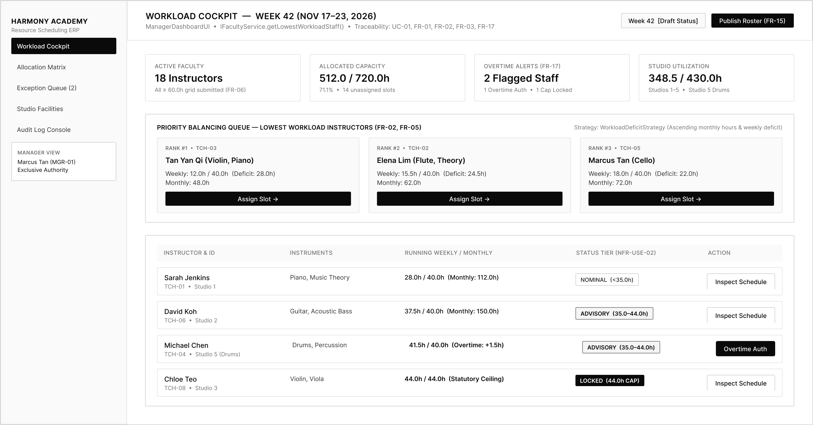
  <em style="color: #666; font-size: 10pt;">Figure 5.1: Manager Scheduling, 3-Tier Workload Status & Studio Utilisation Cockpit Wireframe</em>

### 5.2 Allocation Matrix & Conflict Feedback View
- Use Cases: `UC-02` (Allocate Lesson Slot), `UC-03` (Review & Re-allocate), `UC-06` (Substitute Reassignment)
- Requirements: `FR-03`, `FR-04`, `FR-05`, `FR-11`, `FR-12`, `FR-14`, `FR-17`, `NFR-PER-02`
- Screen Purpose: Provides side-by-side candidate comparison when assigning a 30-minute lesson slot, displaying each candidate's current workload tier, teaching preferences, and assigned studio location.
- Key Elements:
  1. Side-by-Side Candidate Panel: Displays up to 3 eligible candidates side-by-side with current workload, day and block preferences, and the assigned studio location for the selected date (`FR-04`).
  2. Tie-Breaking Strategy Ranking: Displays the active `ITieBreakerStrategy` ranking order (`FR-05`) with a `"Recommended"` badge on the top-ranked candidate.
  3. Studio Equipment & Maintenance Filtering: Matches required lesson instruments to equipped studios (`FR-14`) and excludes studios scheduled for maintenance periods (`FR-11`).
  4. Warning Tier Overtime Prompt (`40.0h–44.0h`): Displays the overtime confirmation prompt when an assignment places a teacher into the `40.0h–44.0h` warning tier (`FR-17`).

  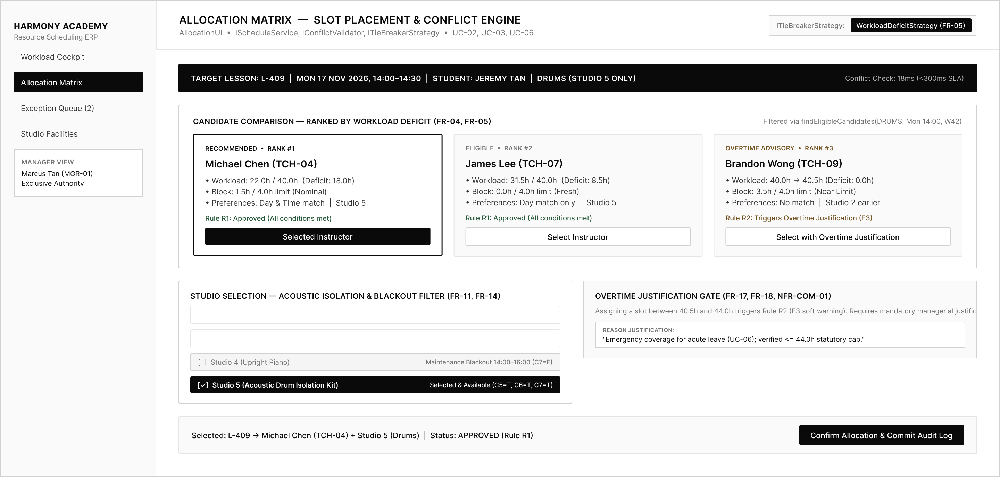
  <em style="color: #666; font-size: 10pt;">Figure 5.2: Allocation Matrix, Candidate Studio Location Display & Conflict Feedback Wireframe</em>

### 5.3 Teacher Availability & Timetable Inspection View
- Use Cases: `UC-07` (Submit Availability), `UC-08` (Submit Preferences), `UC-09` (View Schedule), `UC-10` (Reject Assigned Job)
- Requirements: `FR-01`, `FR-06`, `FR-07`, `FR-08`, `FR-09`, `FR-10`, `NFR-USE-01`, `NFR-SEC-01`
- Screen Purpose: Enables teachers to declare recurring monthly availability, set consecutive block preferences, view confirmed weekly schedules with assigned studio locations and enrolled student details, and flag assigned jobs for rejection discussion with the manager.
- Key Elements:
  1. Recurring 30-Minute Availability Grid: Enforces the 60.0-hour minimum monthly availability declaration before the 19th 23:59 cutoff (`FR-06`) and flags post-19th edits for manager review (`FR-10`).
  2. Personal Weekly Schedule & Assigned Location: Displays confirmed lessons, assigned studio locations (`FR-01`), consecutive block progress against the 4.0-hour limit (`FR-07`), and enrolled student details (`FR-08`).
  3. Job Rejection Discussion Prompt: Captures a teacher's rejection request and routes it for discussion with the manager prior to re-allocation (`FR-09`).

  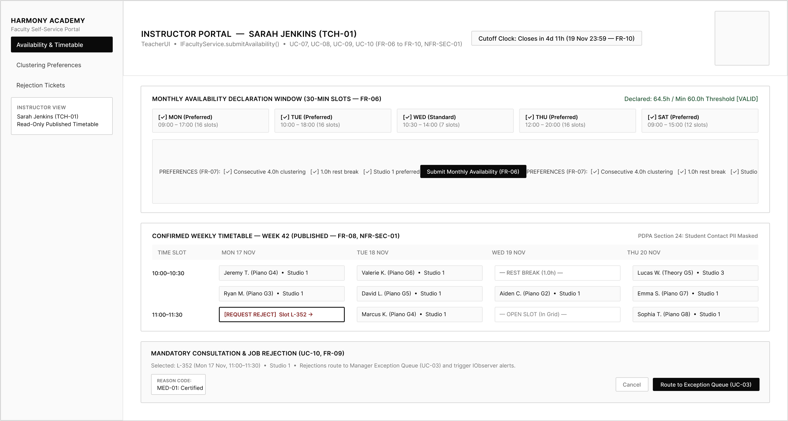
  <em style="color: #666; font-size: 10pt;">Figure 5.3: Teacher Availability Declaration, Personal Timetable & Job Rejection Wireframe</em>

### 5.4 Audit Log Console, Admin Configuration & Design System View
- Use Cases: `UC-11` (Inspect System Audit Log), `UC-12` to `UC-15` (Account & Studio Maintenance), `UC-17` (Review Labor Compliance)
- Requirements: `FR-11`, `FR-13`, `FR-14`, `FR-18`, `NFR-REL-02`, `NFR-COM-01`, `NFR-COM-02`
- Screen Purpose: Provides managers and administrators with an immutable chronological audit trail of all lesson allocations, overtime confirmations, rejection updates, and studio/account configurations, alongside the standardized UI component token sheet.
- Key Elements:
  1. Multi-Parameter Audit Trail Filter: Filters audit entries by date range, actor ID, or action type (`FR-18`).
  2. Regulatory Retention Records: Displays immutable log entries retained for 24 calendar months (`NFR-COM-01`, `NFR-COM-02`).
  3. Design System & 3-Tier Status Tokens: Displays the shared typography, studio location badges, and 3-tier workload status badges (`< 40.0h` OK, `40.0h–44.0h` Warning, `> 44.0h` Overworked).

  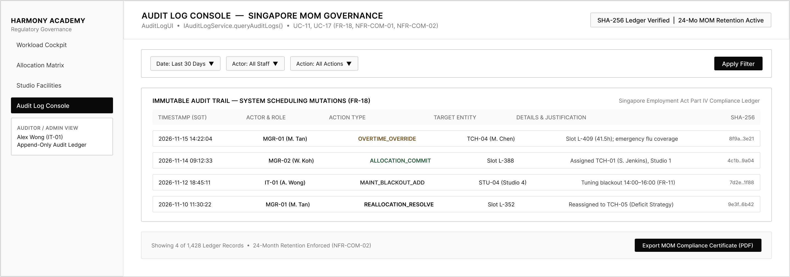
  <em style="color: #666; font-size: 10pt;">Figure 5.4: Regulatory Compliance & Immutable Audit Trail Console Wireframe</em>

  
  <em style="color: #666; font-size: 10pt;">Figure 5.5: UI Design System Component Library & 3-Tier Workload Status Tokens</em>

# 6 References

1. Booch, G., Rumbaugh, J., & Jacobson, I. (2005). *The Unified Modeling Language User Guide* (2nd ed.). Addison-Wesley Professional.
2. Gamma, E., Helm, R., Johnson, R., & Vlissides, J. (1994). *Design Patterns: Elements of Reusable Object-Oriented Software*. Addison-Wesley.
3. McCabe, T. J. (1976). A Complexity Measure. *IEEE Transactions on Software Engineering*, SE-2(4), 308–320.
4. Ministry of Manpower Singapore. (2026). *Employment Act (Chapter 91) — Part IV: Hours of Work, Rest Days and Other Conditions of Service*. Singapore Statutes Online.
5. Personal Data Protection Commission Singapore. (2024). *Advisory Guidelines on Key Concepts in the Personal Data Protection Act (PDPA Section 24: Protection Obligation)*.
6. Pressman, R. S., & Maxim, B. R. (2020). *Software Engineering: A Practitioner's Approach* (9th ed.). McGraw-Hill Education.
7. World Wide Web Consortium (W3C). (2023). *Web Content Accessibility Guidelines (WCAG) 2.2 — Rule 1.4.1: Use of Color*. W3C Recommendation.
